# Apollo 2 user manual

Everything the firmware can do, screen by screen and setting by setting. For
flashing and first‑time pairing, start with the [README](README.md#getting-started),
or watch [Apollo 2 for Micra — From Setup to Shot](https://youtu.be/2J9Y8xyeB9w),
which covers choosing a board, flashing and setup.

Some rows only appear where the hardware supports them — a switch you don't see
(for example **Wired paddle** on a board without paddle wiring, or
**Brightness** on a board whose backlight can't dim) simply doesn't apply to
your board.

**Contents:**

- [Where everything lives](#nav-map) — a map of every screen and setting
- [Home](#home) — MICRA card · SCALE card · BENCH card · Flow graph · Shot lifecycle
- [Settings → Micra](#settings-micra) — Bluetooth · Controls · Cleaning · Schedule
- [Settings → Scale](#settings-scale) — Bluetooth · Shot settings · Device
  settings · Display · Per‑scale nuances
- [Settings → Apollo](#settings-device) — Display · Time & date · WiFi ·
  Backup · Storage · Root page
- [Stats](#stats-section) — Brew/Boiler graphs · History · Info
- [Brew‑by‑weight quick reference](#bbw-reference)

---

<a id="nav-map"></a>

## Where everything lives

<!-- Keep this map in sync with the UI: when a setting/page is added, moved,
     or renamed, update the tree below (and the prose sections). -->

Every screen and setting, and how to reach it:

```
Home
├─ MICRA card — status · BREW/STEAM temps + set-point steppers
│  ├─ [Power]  Standby / Turn On / Connect
│  └─ [Flush]  quick group rinse                *(wired-paddle boards)*
├─ SCALE card — status · WEIGHT (+ target) · TIMER   *(espresso scale paired)*
│  ├─ [shot-mode pill]  Auto shot → Shot detect → Manual  (Reset in review)
│  ├─ [Connect/Disconnect] · [Tare]
│  └─ [ESPRESSO | BENCH]  swaps in the BENCH card   *(bench scale paired,
│                         "In the scale card")*
├─ BENCH card — status · WEIGHT (→ Record <dose>) · [Disconnect] · [Tare]
│                *(bench scale paired; beside the graph, or behind the switch above)*
└─ Flow graph — legend chip: live g/s ↔ g (espresso) · live bench g
                · dose chip above it: <in> g in → <out> g out · 1:ratio (×  clears)
                · freezes for review after a shot

Settings
├─ Micra
│  ├─ Bluetooth — Scan · saved machine (Setup / Connect / Forget) · Auto connect
│  ├─ Controls  — Wired paddle* · Paddle wiring* · Chime melody* · Chime volume*
│  │             · Brew temperature · Boiler enable · Boiler temperature
│  ├─ Cleaning* — Auto flush · Flush delay · Backflush cleaning  → cleaning mode
│  └─ Schedule  — Auto-standby when idle · Show auto-standby timer
│                · Enable schedules · Same every day · Smart Warm-up
│                └─ Configure schedule — day chips · Day enabled · On at / Off at
│                                        · range slider · Copy times to
├─ Scale
│  ├─ Bluetooth       — Scan → Espresso / Bench · saved scales (ESPRESSO / BENCH:
│  │                    Connect / Forget) · Swap roles · Umbra pairing
│  ├─ Shot settings   — Target (Learned drip · Reset) · Review hold · Detect lead-in
│  │                    · Record dose · Default dose · Container 1–2 (Capture / ×)
│  ├─ Device settings — Scale (Espresso / Bench picker)
│  │                    · the scale's own settings (Beep · Auto-off/sleep · Unit …)
│  │                    · paired Umbra: Battery drain per day · Calibrate drain
│  └─ Display         — Battery display (Icon / Percent / Icon + %) · Smoothing
│                       · Drop negative g/s · Oscilloscope graph · Window growth
│                       · Bench scale on Home (In the scale card / Beside the graph)
├─ Apollo
│  ├─ Display     — Brightness* · Screen timeout · Idle screen (Lion/Apollo/Alternate/Dim/Off)
│  │               · Theme · Fahrenheit · Button sounds* · Performance overlay
│  │               · Detailed log
│  ├─ Time & date — Time · Date · 24-hour · Timezone
│  ├─ WiFi        — Enable · Status · Set up WiFi → QR portal (network, time zone,
│  │                 DHCP / static address) · Forget
│  │               · Auto time (NTP) · Check for updates (Off/Boot/Daily/Hourly)
│  │                 → notice → Install now · Beta updates
│  ├─ Backup      — On the card · Back up to card · Restore from card
│  └─ Storage     — SD card status · Mount / Unmount · Card · Space
└─ Lock display for cleaning  → 30 s touch lock

Stats
├─ Brew | Boiler — temperature history graphs (+/− zoom)
├─ History — headline stats (tap → reset) · month filter · shot list
│            └─ tap a shot → full-screen shot card (with delete)
└─ Info — firmware (→ Check for updates) · uptime · IP (DHCP/static) · NTP synced · Diagnostic log
          (tap → viewer) · Micra details

  * = only on boards whose hardware supports it (see the note above)
```

---

## Home

**First boot.** Until a Micra is paired, the device opens on a welcome screen
listing the three recommended steps, each with a button: **Set up WiFi**
(starts the phone setup page, where you enter the network and, optionally,
your time zone — that sets the clock over NTP and enables updates and the
schedule), **Pair Micra** (Settings → Micra → Bluetooth; have your token
ready) and **Pair scale** (Settings → Scale → Bluetooth). A step already done
drops its button. Every step is optional — skip one and Apollo still works,
just without what it brings. **Later** closes the screen until the next
power‑up, so a power cycle mid‑setup loses nothing; **Don't show again** stops
it for good, and pairing the Micra stops it on its own.

  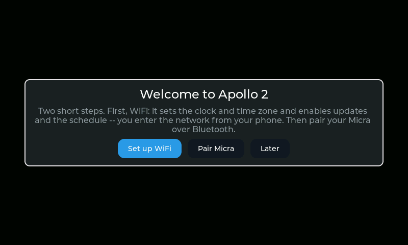

The Home screen adapts to the screen size and to whether a scale is paired.
Without a scale, the MICRA card fills the screen as a single hero:

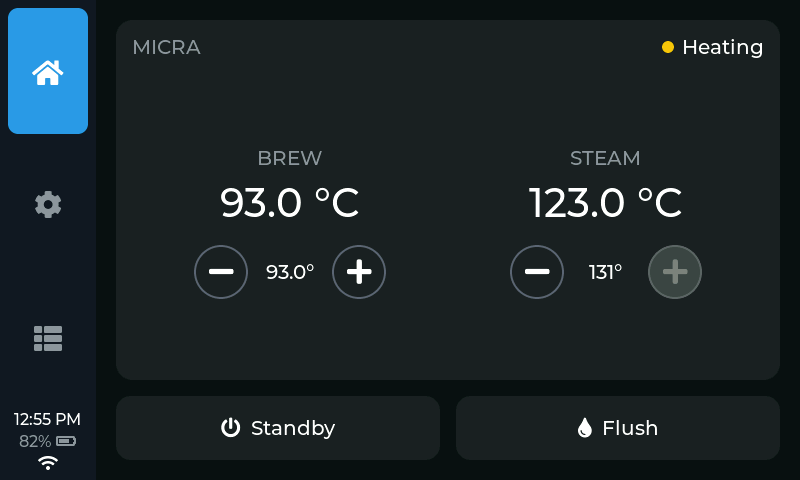

### MICRA card

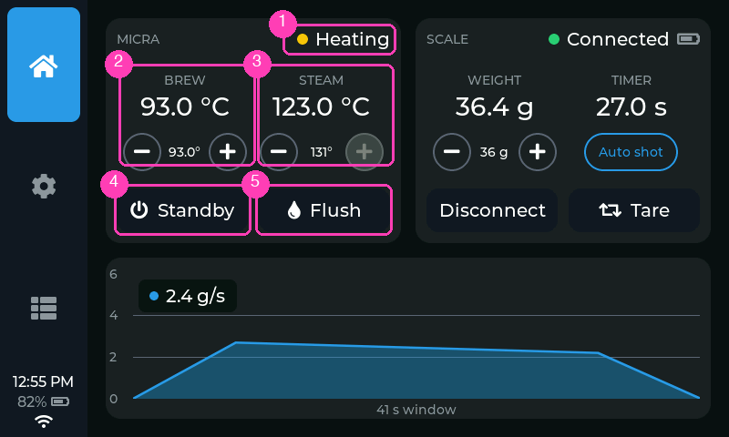

- ① **Status** — `Not set up` (no machine chosen yet), `Setup unfinished`
  (a machine is chosen but pairing never completed — in both of these the Power
  button reads **Pair Micra** and takes you straight to Settings > Micra >
  Bluetooth), `Disconnected`, `Connecting...`, `Heating` (powered on, boilers still coming
  up to temperature — the dot pulses amber), `Ready` (at temperature), or
  `Standby`. The Micra itself doesn't report a warm‑up state; `Heating` is
  inferred from the live boiler temperatures vs their set‑points. A boiler
  within **2 °C** of its set‑point counts as ready, because the machine's own
  thermostat works to about that tolerance — a steam boiler set to 128 °C
  routinely settles at 127 °C and stops heating there. Boards with a speaker
  can also chime when it turns `Ready` — see
  [Settings → Micra → Controls](#controls).
  While **Auto‑standby** is counting down (and *Show auto‑standby timer* is
  on), the header also shows the minutes left next to the caption:

  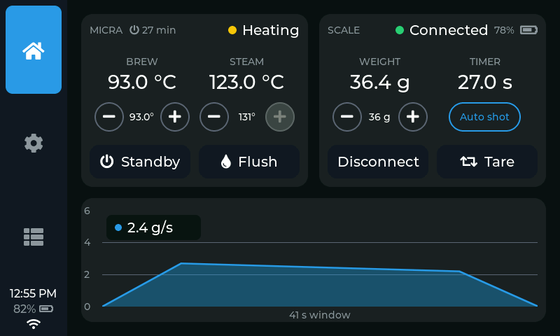

- ② ③ **BREW / STEAM** — live boiler temperatures. On larger screens each has a
  **−/+** stepper that edits the set‑point directly; the small grey number is
  the current target. Edits are written to the machine as you tap.
- ④ **Power button** — `Standby` / `Turn On` when connected. After a tap it
  briefly reads `Working...` (disabled) until the machine reports the change —
  the Micra's answer trails the command by a couple of seconds, and the button
  would otherwise look like it did nothing (a command sent by the
  [Schedule](#schedule) shows the same). When the machine is configured but
  disconnected it becomes **Connect** and starts the Bluetooth link.
- ⑤ **Flush** *(paddle‑wired boards, screens 4.3" and larger)* — runs the group
  for a quick rinse, for the same time as **Auto flush** (3 s when Auto flush
  is Off). Tap again while it runs to stop early; it also reads **Stop** while
  an auto flush is running, and stops that. Greyed out while a shot is in
  flight or the machine is in standby.

### SCALE card (when an espresso scale is paired)

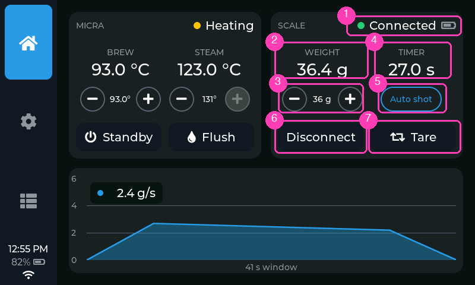

- ① **Status** — `Connected`, `Connecting...`, or `Sleeping` (sleep‑capable
  scales such as the Acaia Umbra with the link switched off). A small battery
  icon shows the scale's own battery where the scale reports it. For a
  paired Umbra that has slept, it is an *estimate* — the percent reads `~41%`
  (see **Battery drain per day** under Device settings).
- ② **WEIGHT** — live reading. During a finished shot's review it freezes at the
  net shot weight so lifting the cup doesn't wipe the number you care about.
- ③ **TARGET** — the brew‑by‑weight stop target in grams (**−/+** on larger
  screens; also under **Settings → Scale → Shot settings → Target**).
- ④ **TIMER** — the shot timer. Runs from the ESP's own clock whenever the
  firmware is the shot authority (Auto shot or Shot detect, and every wired
  shot); in Manual mode without a wire it falls back to the scale's built‑in
  timer.
- ⑤ **Shot mode pill** (under the timer) — tap to cycle the shot mode:
  - **Auto shot** *(only with a wired paddle — see below)*: flipping the
    Micra's paddle starts the shot (auto‑tare, timer, graph), and the firmware
    opens the paddle circuit by itself when the weight reaches
    *target − overshoot*. The overshoot compensation is learned from each
    auto‑stopped shot's settled weight, so accuracy improves over the first
    few shots.
  - **Shot detect** *(needs a paired scale — with none paired the firmware
    runs in Manual mode whatever was last chosen, and the pill isn't shown)*:
    no wiring needed — the shot is detected from the weight
    stream alone (start when flow sustains, stop when flow ceases). There is
    no auto‑stop; instead the pill flashes **Stop** when the shot reaches the
    point where the auto‑stop would have fired, telling you to flip the
    paddle now. Detection confirms a few seconds after the first drip; the
    moment it does, the timer, weight and graph snap to the full shot —
    back‑dated to the estimated start, including the **Detect lead‑in**
    (see **Settings → Scale → Shot settings**).
  - **Manual**: nothing armed. A wired board still relays the paddle and times
    the shot; otherwise the scale's own timer is shown.
  - While a finished shot is frozen for review the pill reads **Reset** —
    tap it to dismiss the review and return to live monitoring.
  - The pill is disabled while a shot is running or settling.
- ⑦ **Tare** — zeroes the scale. (Tares are sent twice under the hood; some
  scales drop single tare commands.)
- ⑥ **Disconnect / Connect** — drops or re‑establishes the scale link, e.g. to
  save the scale's battery.
- Like the shot‑mode pill, **Tare** and **Disconnect** are disabled while a
  shot is running or settling — either would disturb the weight the stop math
  runs on. They re‑enable the moment the shot is over, however it ends.

### BENCH card (when a bench scale is paired)

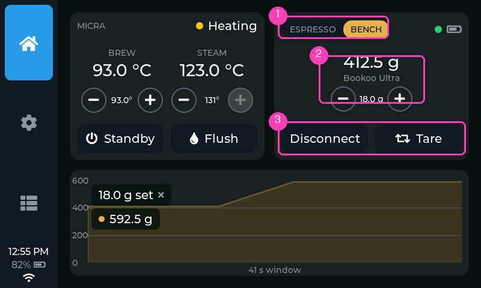

A second scale for the counter — the one you weigh milk or beans on, whose
own screen a jug or plate hides. It is a readout only: the espresso scale
keeps every shot role (Auto shot, Shot detect, the tare at shot start, the
auto flush), and nothing on this card is ever disabled by a shot.

- ① **ESPRESSO | BENCH** — with **Bench scale on Home** set to *In the scale
  card* (the default), the SCALE card's caption becomes this switch. Tap
  **BENCH** to swap the bench card in; tap **ESPRESSO** to swap back. A shot
  starting swaps back by itself, so a shot is never hidden. The status dot
  and battery stay in the header in both positions.
- ② **WEIGHT** — the bench scale's live reading, with the scale's name as
  its caption (above it on the swap card, on the same lines as the MICRA
  card's BREW and STEAM; under it on the card beside the graph). Battery
  and status follow the same rules as the SCALE card's. When what sits on
  the scale looks like a dose, the caption and reading become the
  **Record** button — see *Recording your dose* below.
- ③ **Disconnect / Connect** and **Tare** — the bench scale's own.
- With **Bench scale on Home** set to *Beside the graph*, the bench card sits
  to the right of the flow graph instead (with just **Tare**), and the graph
  draws both scales — see below. Both placements are shown in **Settings →
  Scale → Display**.

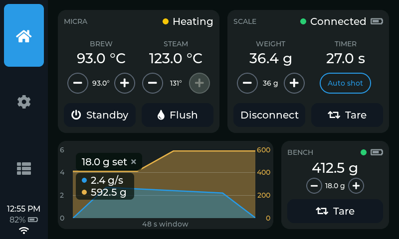

A bench scale with *no* espresso scale paired takes the SCALE card's place by
itself, and the graph shows it in grams.

#### Recording your dose

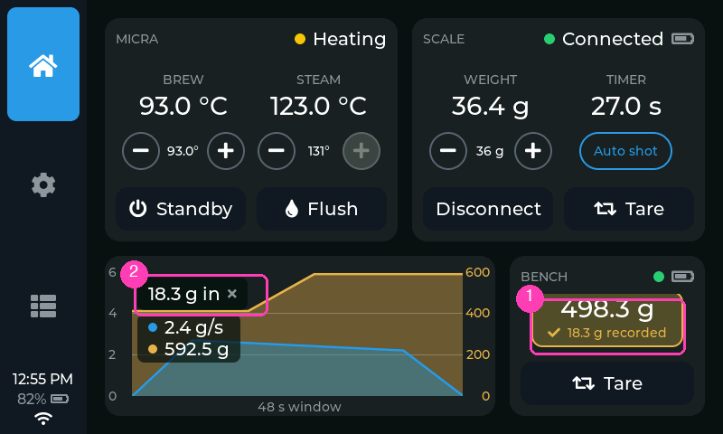

Apollo can keep the **dose** (grams in) with each shot and show the **brew
ratio** (in : out) in the graph and in History. It is off until you turn it
on, and it has two independent switches under **Settings → Scale → Shot
settings**:

- **Record dose** — the feature itself. Off (the default), none of this
  exists: no Record offers on the bench card, no dose chip in the graph,
  no ratio in History. On, Apollo offers to record a dose whenever one is
  weighed on the bench scale, and shows the ratio for a shot that has one.
  It needs an espresso scale paired, since the ratio needs the shot's yield.
- **Default dose** — optional, and off by default too. On, a dose you set
  once (18.0 g to start, 5–30 g) is used for every shot you *don't* weigh,
  so a constant daily dose needs no weighing at all — and the ratio works
  even with no bench scale. Off, the only doses are the ones you weigh.

**Weighing a dose.** Put the dosed portafilter (or your dosing cup, or beans
in a tared cup) on the bench scale. Once the reading has held still for a
second and is dose‑sized, the weight and its caption gain an amber outline
and the caption reads **Record 18.3 g** — the dose Apollo would store ①. Tap
it to record; the caption turns to **✓ 18.3 g recorded** until you lift the
portafilter, and a chip appears above the graph's legend ② with the dose:
**18.3 g in**. While that dose waits, the bench card offers nothing more,
whatever you put on the scale; to change it, tap the chip's **×** and record
again. That dose belongs to the **next shot you start**: when the
shot begins the chip adds a placeholder for the yield (**--.- g out**), fills
it in live as the shot runs with the ratio growing beside it, and freezes
with the graph for review (**36.4 g out · 1:2.0**).

- **Containers.** Nothing is subtracted for a tared cup. For a portafilter
  or a dosing cup that is *not* tared, store its weight once under **Shot
  settings → Container** and Apollo subtracts it by itself: the reading is
  matched to the heaviest stored container lighter than it, so a 498 g
  reading with a 480 g portafilter stored records 18 g. Apollo measures the
  *step* the load made on the scale (from whatever it read before), so you
  don't have to tare first — a spoon already on the scale, or a cup you
  tared earlier, makes no difference. Weighing in stages is fine too: beans
  added to, or taken out of, what is already on the scale change the offer
  to the new total, so 8 g topped up to 10 g offers **Record 10.0 g**. Only
  lifting the load, putting a container down, or taring (on Apollo or on
  the scale) starts the count over.
  Record is only offered for a step whose dose would be 5–30 g — a milk
  jug never offers it.
- **A dose clears** when you tap the **×** on the chip, when the shot it
  belongs to starts, or when you've evidently walked away: the
  screensaver starting, a scale going to sleep (a link that drops and stays
  down half a minute), the Micra going to standby, or an hour passing.
- **The default dose** is staged for every shot: the chip shows it as
  **18.0 g set**, and a dose you weigh overrides it for that one shot. The
  **×** on a staged default skips it for the next shot only; it is staged
  again after that shot, or when you've walked away as above. While the
  switch is on, the BENCH card carries a **− / +** for the value — on the
  swap card in the row the other cards' steppers use, beside the graph in
  the scale name's place (a Record offer takes that line back while it
  shows) — so it can be dialled without leaving Home. Switch it off and
  those controls go with it.
- **History** keeps which kind each shot had: a weighed dose reads
  **18.2 g in** on the shot's card, a default **18.0 g default**, so a ratio
  can be told apart as measured or assumed. The web page shows the same.

### Flow graph

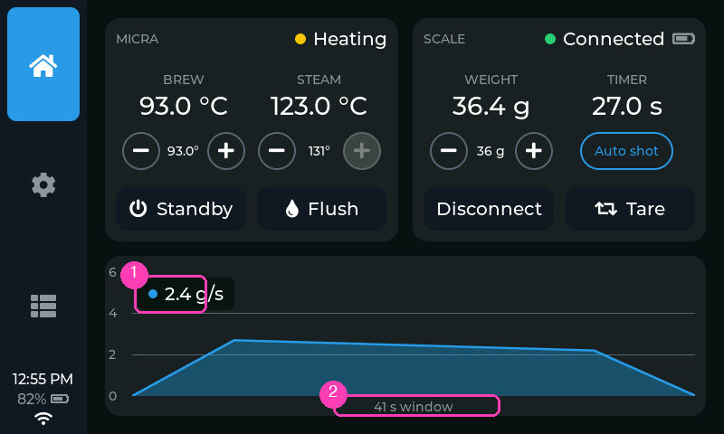

Plots the live flow rate (or weight) from the scale.

- The chip ① is a legend with live values: a coloured dot per scale and the
  current reading in that series' unit — the espresso scale's flow rate
  (or weight), the bench scale's grams. Tap it to switch the espresso trace
  between flow rate (g/s) and weight (g); the caption ② names the time
  window in view. A staged dose adds its own chip above the legend that
  builds up over the shot; only its **×** is a control — see *Recording your
  dose* under the BENCH card.
- With a bench scale, the **BENCH** side of the swap card shows the bench
  scale's weight in grams instead (its own amber trace, hundreds of grams on
  the axis). *Beside the graph*, both scales share the plot: the espresso
  trace against the left axis in its unit, the bench weight in amber against
  its own right‑hand axis in grams, and the legend carries both dots.
- During a shot the graph restarts and follows the shot, widening its time
  window as the shot runs on (see **Window growth**); when the shot ends it
  freezes for review (see **Review hold**) and then resumes.
- The graph style (oscilloscope sweep vs scrolling) and smoothing are set under
  **Settings → Scale → Display**.

### Shot lifecycle notes (all modes)

- A run shorter than **8 seconds** never becomes a "shot" — it's treated as a
  flush/rinse and discarded silently. Shot detect additionally requires a few
  grams of net gain.
- **Auto shot and Shot detect refuse to start without the scale.** Flipping
  the paddle while the scale isn't connected leaves the machine off and pops a
  message — connect the scale (or wake it) or switch to **Manual** mode. This
  catches the "flipped the paddle, then noticed the scale was never set up"
  shot. Waking a standby machine with a paddle flip still works (no water
  moves), and deliberate untracked runs remain available via Manual mode or
  the **Flush** button.
- On wired boards, flipping the paddle ON **while a review is frozen** is
  swallowed (the machine does not start) and the **Reset** pill flashes —
  dismiss the review first, then start the next shot. This prevents an
  expected auto shot from silently running as a manual one.

---

<a id="settings-micra"></a>

## Settings → Micra

### Bluetooth (machine)

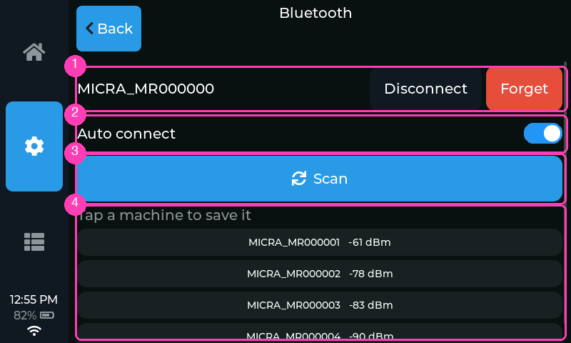

- ③ **Scan** — searches for La Marzocco machines; found machines list below ④,
  tap one to save it. Scanning takes priority over
  in‑progress background connections (a scale stuck in `Connecting...` no
  longer blocks it). If nothing is found the status line says so — make sure
  the machine is powered on and in range, then scan again.
- ① **Saved machine row** — shows the paired machine with:
  - **Setup** (only until a token is stored) — starts the token entry flow
    (see the [README](README.md#4-enter-your-token)):

    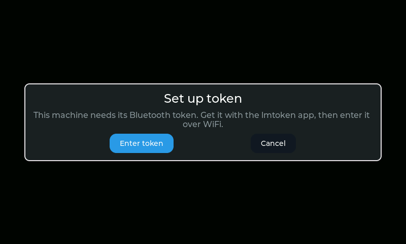

  - **Connect / Disconnect** — manual link control. The Micra accepts only one
    Bluetooth client, so Disconnect frees it for another remote or the phone
    app.
  - **Forget** — clears the machine, its name, and its token.
- ② **Auto connect** *(default on)* — connect to the saved machine automatically
  at power‑up. Turn off if another controller needs the Micra's single
  Bluetooth slot.

### Controls

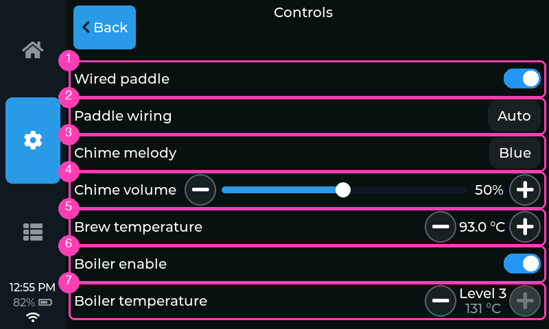

- ① **Wired paddle** *(paddle‑capable boards; default off)* — tell the firmware
  the paddle harness is physically wired. This enables the **Auto shot** mode
  and the auto‑flush. Off, the board behaves like an unwired one (Shot detect
  / Manual only) — the paddle still runs the machine, but without the shot
  timer, Auto shot or cleaning, so the first paddle flip the firmware sees
  with this off pops a one‑time reminder pointing here. Flipping it mid‑shot
  cancels the shot.
- ② **Paddle wiring** *(P4 boards; Auto / Apollo Link / Opto cable, default
  Auto)* — which of the board's two paddle pin sets your cable uses: the
  corner pins (GND · 52 · 51) for the opto cable, or the pins at the 5 V
  end for an Apollo Link. **Auto** watches both, which is how every unit has
  always worked and needs nothing from you. Pick your wiring to have the
  firmware ignore the unused set entirely — worth doing, because a pin on the
  unused set that fails or gets shorted can otherwise hold the paddle "on".
  Changing it cancels any shot in progress.
- ③ **Chime melody** *(boards with a speaker; Off / Blue / Pink / Human /
  Gold / White / Autumn / Random, default Blue)* — which tune announces the end of a warm‑up. Each tap
  cycles to the next melody and auditions it; **Random** picks a different
  tune each time the machine warms up; `Off` silences the chime regardless of
  the volume below.
- ④ **Chime volume** *(boards with a speaker; 0–100 %, default 80 %)* — the
  warm‑up chime's level, so you can walk away and be called back. Drag the
  slider to get close, or tap **–** / **+** to nudge it 5 % at a time; either
  way it **plays a note at the new level** so you can set it by ear. `0 %`
  shows as `Off` and silences it. The scale is even *to the ear* rather than
  arithmetically — each step is the same size in loudness, so the lower half
  is as useful as the upper half.

  The chime marks the *end of a warm‑up*, not every moment the boilers are at
  temperature, so it sounds **at most once per turn‑on** and then stays quiet
  through everything the session brings — the small dips and reheats that hold
  the temperature, heavy steaming, refills, steam boiler toggles. It re‑arms
  only when the machine goes to standby (or off, or disconnects), so the next
  turn‑on's warm‑up chimes again. With the steam boiler **off** the chime
  follows the coffee boiler alone; with it **on**, both boilers have to be
  there.
- ⑤ **Brew temperature** — coffee boiler set‑point stepper (0.1 °C steps;
  long‑press for 0.5 °C).
- ⑥ **Boiler enable** — steam boiler on/off.
- ⑦ **Boiler temperature** — one of the Micra's three steam levels (shown as
  Level 1–3 with the temperature underneath).

### Cleaning *(paddle‑capable boards)*

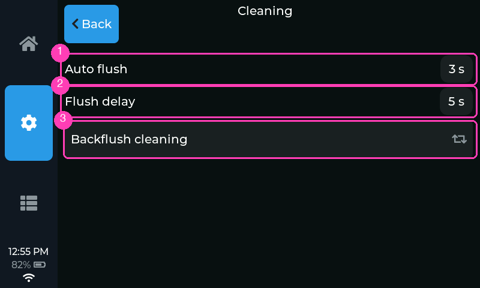

Everything that deliberately runs water through the group. The whole page
needs the paddle harness, since that's what drives it: with **Wired paddle**
off (Settings → Micra → Controls) every row here is greyed out and a line at
the top says so.

- ① **Auto flush** *(Off / 3 / 6 / 9 / 15 s; default Off)* — after a finished
  shot, when the scale sees the cup lift off, the firmware waits (see **Flush
  delay**) and then runs the group for this long to rinse the puck's surface.
  Before it starts, flipping the paddle on, a new shot, or the machine being in
  standby cancels it. Once it is running the paddle is ignored — flipping it
  back to rest won't cut the rinse short — and the Home **Flush** button reads
  **Stop** to end it early.
  **This one duration drives every timed group run**: the auto‑flush, the Home
  **Flush** button, and each backflush pulse. With Auto flush Off the other two
  fall back to 3 s.
- ② **Flush delay** *(shown while Auto flush is on; 5 / 10 / 15 s; default
  5 s)* — the pause between the cup coming off and the flush running. A
  3, 6 or 9 s delay set before v1.0.2 stays in force until you tap the row.
- ③ **Backflush cleaning** — opens a full‑screen cleaning mode. Fit the blind
  filter with detergent, tap **Go**, and the device pulses the group **10
  times: ⟨Auto flush⟩ seconds on, 3 seconds off**, showing the cycle count, a
  countdown, and the total up front. **Cancel** stops the sequence and stays on
  the screen so you can run it again; **Back** stops it and leaves. Flipping
  the physical paddle also stops it — you always outrank the automation. When
  it finishes, rinse the basket and run it again with plain water to clear the
  detergent. Greyed out unless the machine is on and no shot is in flight.
  - **Preinfusion/prebrew matters here.** Each pulse starts a fresh brew, so
    the machine preinfuses *every time*. A pulse shorter than your preinfusion
    never engages the pump, so it runs at line pressure only — water still
    flows and it still rinses, just with far less force than a pump‑pressure
    backflush. If that's not what you want, either raise **Auto flush** until
    the pulse comfortably outlasts preinfusion, or turn preinfusion off while
    you backflush.

  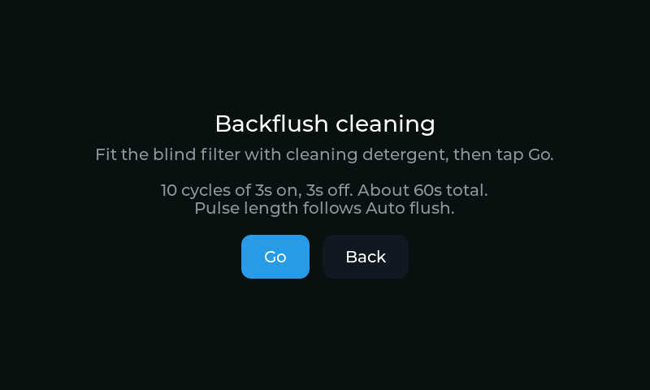

<a id="schedule"></a>

### Schedule

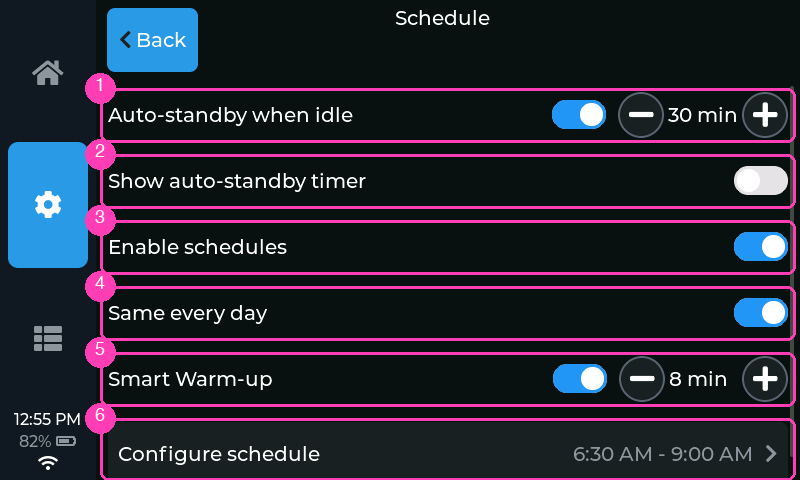

Turns the machine on and sends it to standby at set times, from the device's
own clock, so it is warm when you walk up and asleep when you don't. Two
pages, neither of which scrolls: **Schedule** holds Auto‑standby and the
schedule switches, one per line, and **Configure schedule** holds the times.
**The schedule rows are greyed out until two things hold:** a paired Micra,
and a clock the device can trust — WiFi on with **Auto time (NTP)** synced
since the last power‑up (see [Settings → Apollo → WiFi](#wifi)). The page
doesn't say which is missing; if the rows won't take a tap, check those two.
Auto‑standby needs only the paired Micra. The first time you open the page a notice asks you to turn off any
schedule in the La Marzocco app — two schedules for one machine conflict and
confuse. **OK** dismisses it until the next restart; **Don't show again**, for
good.

- ① **Auto‑standby when idle** *(default off, 30 min; 10–240 in
  10‑minute steps)* — independent of the schedule rows below: sends the
  machine to standby this long after you last **used** it — a shot (in any
  mode, a Manual pull included), a flush or a backflush — like the Micra's
  own auto‑standby. Each of those restarts
  the count, and none of it fires while one is running; a machine that was
  switched on but never used is left alone, so a scheduled turn‑on stays up
  until you use it (and a scheduled turn‑on cancels a running count). It needs only a
  paired Micra — no WiFi, no clock, and it works with the schedules switched
  off. It does need to *see* shots, though: through a wired paddle, or a
  paired scale in Shot detect mode. With neither, a line under the row says
  so and the count can never start.
- ② **Show auto‑standby timer** *(default off)* — while a count is running,
  the Home MICRA card shows the minutes left next to its caption (see
  [MICRA card](#micra-card)).
- ③ **Enable schedules** *(default off)* — the master switch for the timed on
  and standby. Off keeps the times you set and greys out the rows below it;
  Auto‑standby is not affected.
- ④ **Same every day** *(default on)* — one window for the whole week. Turn it
  off for per‑day times: the Configure schedule page grows a row of day chips
  (below) and each day gets its own On at / Off at. **Turning it off copies
  the daily window onto all seven days** as the starting point, so you only
  edit the days that differ.
- ⑤ **Smart Warm‑up** *(default on, 8 min; 0–30)* — starts the machine this
  many minutes *before* On at, so the boilers are at temperature by the
  scheduled time. One setting for the whole week. A lead that reaches past
  midnight simply starts the evening before.
- ⑥ **Configure schedule** — opens the times page below. The row shows the
  current window at a glance, or *Per day* once the days differ.

  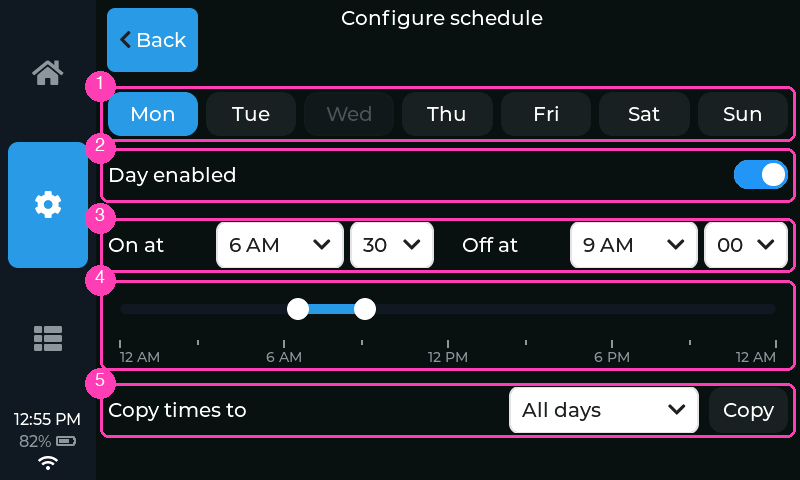

- ① **Day chips** *(Same every day off)* — pick which day the rows below edit.
  A day that is switched off reads faded.
- ② **Day enabled** *(Same every day off)* — whether the selected day takes
  part. Off greys the time controls beneath and the schedule skips the day;
  its times are kept.
- ③ **On at / Off at** *(5‑minute steps; default 6:30 → 9:00)* — the window.
  Off is always later than On on the same day (a window never crosses
  midnight); moving one end past the other pushes the other along.
- ④ **Slider** — the same window as a bar across the day, midnight at the
  left edge and 23:55 at the right, with an hour axis underneath (a tick every
  three hours, labelled at 6 AM, noon and 6 PM). Drag either end; the pickers
  follow, and vice versa.
- ⑤ **Copy times to** *(Same every day off)* — copies the shown day's On at /
  Off at onto the picked day, or onto **All days**, without changing which
  days are switched on.

How it behaves:

- **The times are triggers, not a period.** On at switches the machine on
  once; Off at sends it to standby once. Between them do as you like — switch
  it off by hand and it stays off; switch it on early and On at simply finds
  it already on.
- **Auto‑standby counts from the last use, not from turn‑on.** Turn the
  machine on by hand and do nothing, and it stays on; pull a shot, run a
  flush or a backflush and the count starts, restarting with each. If the
  count runs out mid‑shot, during the review or mid‑cleaning, it simply
  restarts when that ends. Standby by
  any route — you, the schedule, this — ends the count, and a machine
  already in standby makes the scheduled Off at a no‑op.
- **Standby waits for the shot.** If Off at lands while a shot is running,
  still under review or a cleaning cycle is going, standby holds until the device has been idle for about
  two minutes (long enough for the auto‑flush and the cup to come off), then
  goes ahead if the machine is still on.
- **Only while connected.** A trigger fires only if the Micra is connected at
  that minute (a two‑minute window covers hiccups). If the link is down —
  disconnected on purpose, or the machine off at its switch — that trigger is
  skipped, not queued. Likewise nothing fires while WiFi is off, Auto time is
  off, or no Micra is paired; the times you set are kept for when they are
  back.
- The Home **Power** button reads `Working...` while a scheduled command is in
  flight, and a short notice says what the schedule just did (unless the idle
  screen is up). When Smart Warm‑up is what fired, the notice says so — for
  example *Smart Warm‑up: on 8 min before 6:30 AM* — so an early start isn't
  mistaken for a wrong time.

  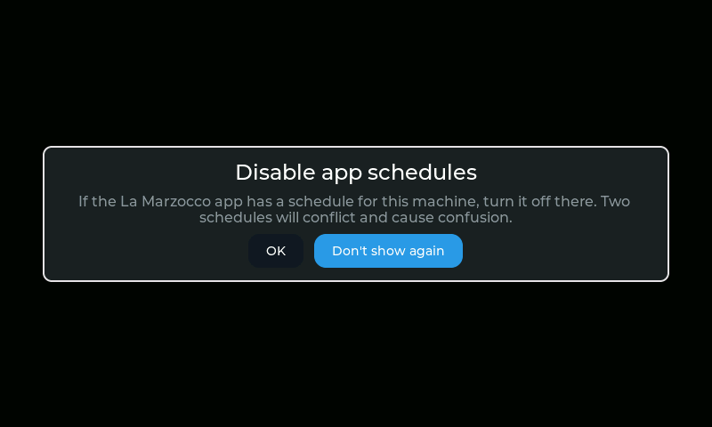

---

<a id="settings-scale"></a>

## Settings → Scale

### Bluetooth (scale)

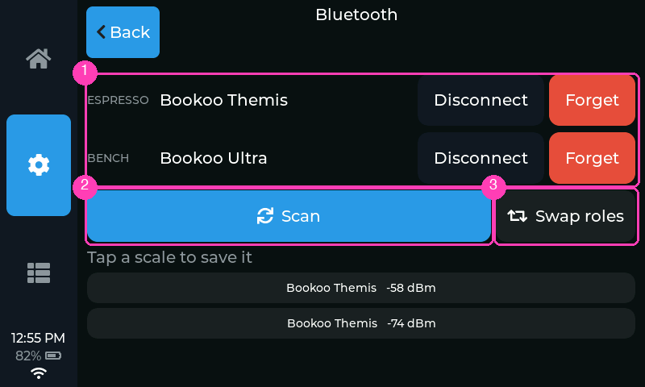

Apollo keeps up to two scales: the **espresso** scale on the drip tray, which
runs every shot feature, and an optional **bench** scale for the counter,
which is a weight readout with its own Tare (see the BENCH card above).

- ② **Scan** — searches for supported scales (Bookoo Themis, Acaia Umbra /
  Lunar / Prochef / Pyxis, Varia Aku — Pyxis and Aku untested). Wake the scale first — most
  sleep their Bluetooth quickly. Tapping a result asks **Use … as which
  scale?** — **Espresso** or **Bench** — and saves it there, replacing
  whatever that slot held. With one scale, choose **Espresso** and you will
  never see a bench row.

  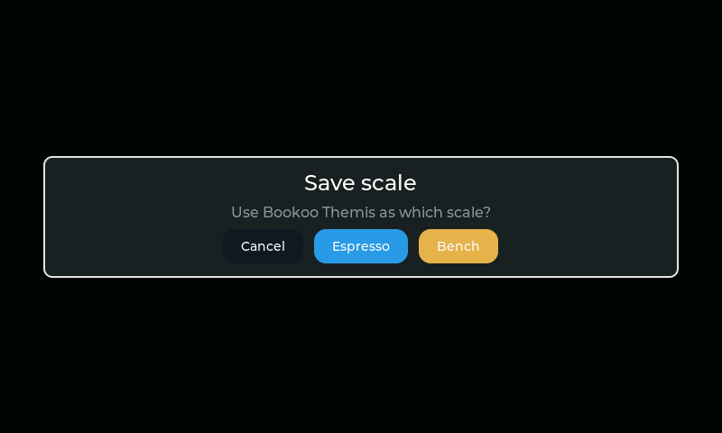
- ① **Saved scale rows** — one per slot, labelled **ESPRESSO** and **BENCH**,
  each with **Connect / Disconnect** and **Forget** (no token needed for
  scales).
- ③ **Swap roles** *(shown once both are saved)* — exchanges the two scales'
  jobs: the slot is the role, so the scale that lands in ESPRESSO takes over
  the shot features. Both scales stay connected through the swap (a paired
  Umbra stays paired); the graph starts afresh, since its history belonged
  to the other role.
- **Pairing an Acaia Umbra** — choosing an Umbra from the scan list offers to
  *pair* it, the way a Lunar does, which keeps the Umbra's sleep/wake
  behaviour on Umbra firmware 1.0.8 (see the per‑scale notes below). The first
  time, Apollo has to **restart once** to get ready (**Restart**), then shows
  **Pairing with Umbra**: hold the Umbra's button until it blinks magenta and
  Apollo confirms by itself. If it hasn't paired after 30 seconds of blinking
  magenta, turn the Umbra off and enter pairing mode again. **Use unpaired**
  skips pairing and connects the normal way, with no restart. A paired Umbra
  may show up as a Lunar ("LUNAR‑APOLLO") in Acaia's app. An Umbra can be
  paired in either slot, but only **one** Umbra at a time: a second one is
  saved as a regular Bluetooth scale and Apollo says so.

### Shot settings

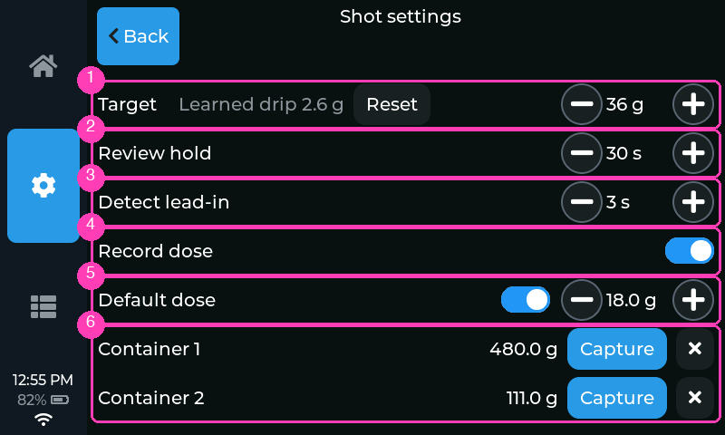

- ① **Target** — brew‑by‑weight stop target, 5–120 g. Also editable from Home on
  larger screens. Beside it, **Learned drip 2.6 g** is what the auto‑stop
  subtracts from the target to allow for the drips that land after the cut
  (the stop hint's own figure in Shot detect mode). Apollo learns it from
  each auto‑stopped shot, half the error at a time, so after a change of
  beans or grind that moves the drip tail a few shots land short or long
  while it catches up. **Reset** (with a confirm) puts it back to 2.0 g and
  it relearns from the next shots.
- ② **Review hold** *(5–120 s, default 30 s)* — how long a finished shot's frozen
  graph and weight linger before auto‑dismissing. **Reset** dismisses early.
- ③ **Detect lead‑in** *(0–10 s, default 3 s)* — Shot detect mode only. The
  detector notices a shot at the first weight rise, but the shot started
  earlier: you flipped the paddle, then preinfusion water worked through the
  puck before the first drop landed. This offset is added when back‑dating the
  shot start, so the timer and graph line up with the moment you actually
  started the shot. Adjust it to match your machine's preinfusion setting as
  needed (roughly your typical paddle‑to‑first‑drip time); 0 starts the shot
  at the first drip.
- ④ **Record dose** *(off by default; needs an espresso scale)* — the dose
  chip in the graph, the ratio, and with a bench scale the Record block on
  the bench card (see *Recording your dose* under the BENCH card). Off, none
  of it shows and nothing is recorded.
- ⑤ **Default dose** *(switch, off by default; on: 5–30 g in 0.5 g steps,
  18.0 g at first)* — a dose staged for every shot when none was recorded;
  see *Recording your dose*. Off hides the value controls here and on the
  bench card.
- ⑥ **Container 1–2** *(bench scale only)* — the weights Apollo subtracts from a bench reading
  before recording a dose: a portafilter, a dosing cup. Put the empty
  container on the bench scale and tap **Capture**; **×** forgets it. A
  container has to weigh at least 50 g, and two containers have to be more
  than 30 g apart — lighter or closer than that, a dose could be read as
  the wrong thing, so Capture refuses and says why. Tare anything lighter
  instead.

These are all about how a shot *runs*; how the graph *looks* is under
**Display** below.

### Device settings

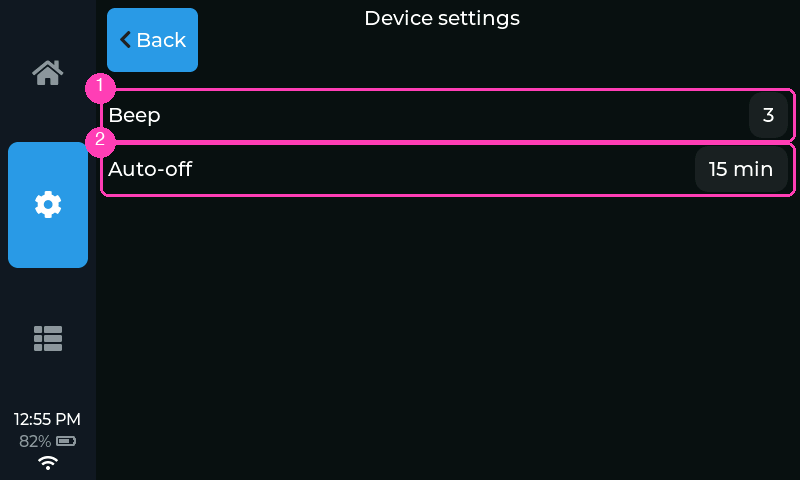

Settings stored on the scale itself, adjusted over Bluetooth. With both an
espresso and a bench scale saved, a **Scale** row at the top picks which one
the rows below address (**Espresso** / **Bench**); with one scale it is that
scale. Which rows appear — and their value choices — depends on the scale
model (a Bookoo Themis's ① **Beep** and ② **Auto‑off** shown above):

- **Bookoo Themis / Themis Ultra** — **Beep** (buzzer level Off / 1–3, the
  same range the Bookoo app offers) and **Auto‑off** (5–30 min). The scale
  also accepts levels 4–5 over Bluetooth, but the firmware plays those
  *quieter* than the real ones, so they aren't offered; one set elsewhere
  shows as `--`.
- **Acaia Umbra** — **Beep** (On / Off; also silences its tare/timer chirps),
  and **Auto sleep** (Off / 1–30 min). The Acaia app can
  additionally set *power‑off* timers; those aren't offered here (a
  powered‑off scale can't be woken over Bluetooth) and show as `--` if set
  elsewhere. A **paired** Umbra adds two battery rows, below.
- **Acaia Lunar / Pyxis** — **Beep** — the row shows the beep volume the
  scale stores (Off / 1–3), but over Bluetooth the beep can only be toggled:
  tapping cycles **off** and **on**, and *on* restores whatever volume was
  last set with the scale's own buttons (Bluetooth can't set a level — even
  the Acaia app is on/off only). Then **Auto sleep**
  (Off / 5–60 min), **Unit** (g / oz), and **Mode** — the scale's current
  weighing mode, shown for reference only (the Acaia protocol has no way to
  change mode remotely; use the scale's buttons).
- **Varia Aku** — none. Its Bluetooth protocol exposes weight, tare and
  battery only, so the page says *No device settings available for this
  scale*.

**Unit** only changes what the *scale's own display* shows — Apollo always
works and displays in grams (an oz‑mode Lunar/Pyxis streams ounces over
Bluetooth; the firmware converts them back, so brew‑by‑weight targets stay
correct). The Umbra has no display and always sends grams, so it has no
Unit row.
Changed values may take a moment to be confirmed by the scale; if a change
doesn't stick, the row snaps back to what the scale reports.
- **Varia Aku** — none (no adjustable settings in its protocol; weight and
  battery only).

The scale owns these values: the rows show what it reports, so they read `--`
until the scale is connected (a **Connect** prompt appears right in the group
when it isn't — no scale paired yet, the group points you to Bluetooth
instead). Tap a value to advance to the next choice; the write goes to the
scale immediately and sticks like any change made from the scale's own
buttons. Like Tare, the espresso scale's rows are disabled while a shot is
running; the bench scale's never are.

#### Paired Umbra: battery estimate

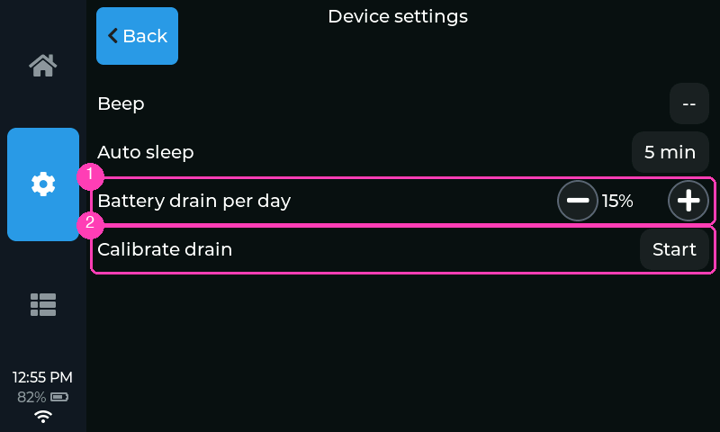

Once an Umbra has been put to sleep, it keeps reporting the battery level it
had when it went to sleep until it is restarted (charging restarts it), on
every app. So while it is asleep, Apollo works the level out instead: the last
level it saw change, less a daily drain for each day since. The estimate shows
with a `~` (`~41%`) and drives the low‑battery warning like a real reading.
The first reading that changes means the scale is reporting again, and it
shows as normal.

- ① **Battery drain per day** *(1–30 %, default 15 %)* — how much charge the
  scale loses per day, asleep or not; for an Umbra, time matters far more than
  how long it's used each day. 13–15 % suits a stock battery.
- ② **Calibrate drain** — measures your scale's own figure. Tap **Start**,
  charge the scale fully, use it as usual until it runs flat, then charge it
  again. When it comes back, Apollo shows the measured drain next to the
  current setting: **Store** saves it, **Discard** keeps the setting (discard
  it if the scale was charged before it ran flat). If the scale is charged
  before Apollo has measured a whole sleep, you see **Calibration
  incomplete** instead; start again to retry. While a calibration is running
  the button reads **Cancel**.

Both rows are greyed out while the Umbra's **Auto sleep** is **Off**: a scale
that never sleeps keeps reporting its battery, and nothing needs estimating.
The estimate needs the clock: a board that hasn't set its time from the
internet since it started keeps showing the last estimate unchanged.

### Display

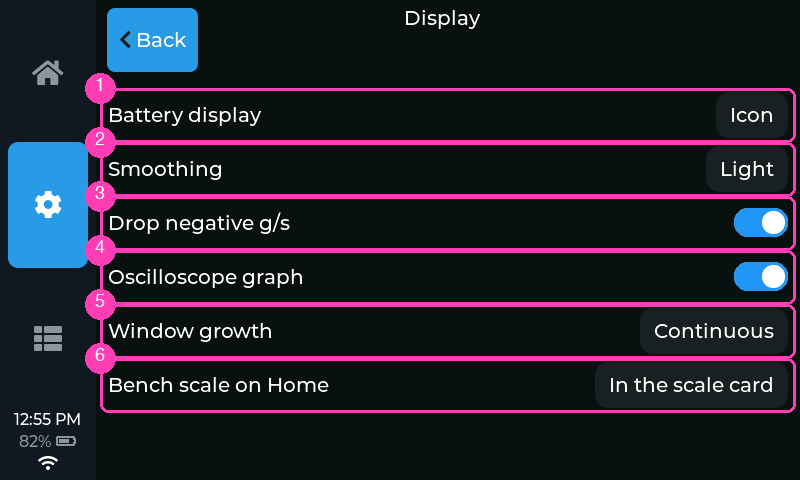

Apollo's own preferences for how the scales show — none of these are sent to
a scale.

- ① **Battery display** — how the scale cards on Home show a scale's battery:
  **Icon** (the level glyph, the default), **Percent**, or **Icon + %**.
- ② **Smoothing** *(Off / Light / Medium / Strong, default Light)* — smoothing on
  the shot graph's line. Purely visual; detection and auto‑stop use the raw
  stream.
- ③ **Drop negative g/s** *(default on)* — clamps negative flow readings (cup
  bumps, scale noise) to zero on the graph.
- ④ **Oscilloscope graph** *(default on)* — the shot graph sweeps left→right and
  wraps, oscilloscope style. Off, it scrolls continuously instead.
- ⑤ **Window growth** *(Snap / Smooth / Continuous, default Continuous)* — how
  the shot graph's time window widens as a shot runs on past 15 s.
  **Continuous** keeps the whole shot filling the width, squeezing the trace
  as it lengthens. **Snap** jumps to 30, 45 and 60 s instead. **Smooth** makes
  the same jumps but eases each one over a second or so. Purely visual.
- ⑥ **Bench scale on Home** *(shown once a bench scale is saved)* — **In the
  scale card** (the default: the SCALE card gains the ESPRESSO | BENCH switch)
  or **Beside the graph** (its own card to the right of the flow graph, and
  both scales on the graph). See the BENCH card under Home.

### Per‑scale nuances & recommended daily workflow

The supported scales handle power and sleep differently, so the smoothest
end‑of‑day / morning routine differs by model. In every case, if the Micra has
an auto‑on schedule, the scale step below is the *only* thing you do — the
machine is already warming up when you arrive.

- **Acaia Lunar / Pyxis** — stays running for as long as Bluetooth is
  connected (it won't auto‑sleep on you mid‑connection), so Apollo drops the
  link when its screensaver or setup portal comes up and the scale's own
  **Auto sleep** (Device settings) takes over. When you touch the screen
  again Apollo reconnects at once if the scale is still awake; if it has
  already gone to sleep, press its button to wake it and Apollo connects on
  its own. Nothing else to do at the end of the day.
- **Acaia Umbra** — **pair it** (Bluetooth above); using it unpaired is not
  recommended. Paired, the Umbra has a real sleep mode Apollo can wake it
  from: either let the screensaver manage it — the Umbra goes to sleep when
  the screensaver starts and wakes when you touch the screen — or tap
  **Disconnect** when you're done (the card shows `Sleeping`) and **Connect**
  when you need it, which wakes it over Bluetooth. Its battery lasts about a
  **week** asleep; once flat, Connect naturally can't wake it, so put it on a
  charger if it's been sitting. *Unpaired* (firmware 1.0.8 and later), the
  Umbra drops the link on its own timer while Apollo sits idle and then
  **powers off** about 5 minutes later, and a powered-off scale cannot be
  woken over Bluetooth: you press its button every morning.
- **Bookoo Themis** — has a sleep mode, but it genuinely powers down: Apollo
  **cannot** wake it with Connect. Leave Apollo
  connecting, **turn the scale on** in the morning and you're good; when
  you're done, just walk away — the scale sleeps on its own from inactivity.

---

<a id="settings-device"></a>

## Settings → Apollo

Three short sub‑pages — **Display**, **Time & date**, and **WiFi** — so each
page fits on screen with little to no scrolling.

### Display

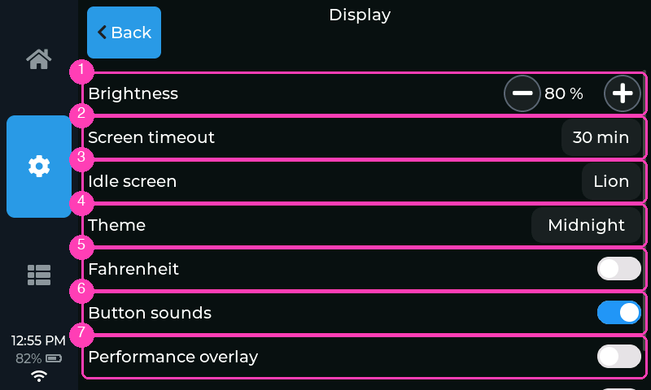

- ① **Brightness** *(dimmable boards)* — backlight level.
- ② **Screen timeout** *(Off / 1 / 5 / 15 / 30 min, default 30 min)* — after
  this idle time the idle screen starts (see the next row); any touch wakes the
  screen. A shot in progress never counts as idle, so the idle screen won't
  cover a live shot no matter how short the timeout — the countdown restarts
  when the shot ends.
- ③ **Idle screen** *(Lion / Apollo / Alternate / Dim / Off, default Lion; shown
  while Screen timeout is on)* — what the timeout shows. **Lion** and
  **Apollo** turn the backlight down (to 10 % on the S3 boards, 5 % on the
  P4s — low enough to read as asleep, high enough that the panel isn't
  mistaken for switched off) and bounce that drawing around a black screen,
  changing color at every wall it hits — the La Marzocco lion, or Apollo
  sipping an espresso. **Alternate** does the same, starting on either one and
  switching to the other every three minutes.
  **Dim** turns the backlight down the same way but leaves the normal screen
  showing, so you can still glance at the machine from across the kitchen.
  **Off** switches the backlight off entirely. On boards whose backlight can't
  be turned down, the drawings and Dim show at full brightness — choose Off
  there to go dark.

- ④ **Theme** — tap to cycle the color scheme: Midnight, Graphite, Espresso,
  Nord, Solarized, Plum, Forest, Rose, Mono (black & white), Contrast (high
  contrast), Ferrari, Sunset, Citrus, Modena, Gulf, Monaco, Ivory. The last
  four (plus Ferrari) are companions to the Micra body colors — the machine's
  paint as the accent: Ferrari red, Modena the yellow Micra, Gulf the light
  blue, Monaco the navy, Ivory the creme.
- ⑤ **Fahrenheit** *(default off)* — display unit for temperatures. Set‑points
  are still stored in Celsius.
- ⑥ **Button sounds** *(boards with a speaker; default on)* — click on button
  presses. (The other sound, the warm‑up chime, is under
  [Settings → Micra → Controls](#controls) since it's about the machine.) With
  button sounds off *and* the chime volume `Off`, the audio hardware stays
  powered down until the next restart.
- ⑦ **Performance overlay** *(default off)* — LVGL FPS/CPU overlay, for
  debugging.
- ⑧ **Detailed log** *(default off)* — keeps the minute-by-minute
  housekeeping in the diagnostic log (performance and memory lines, the
  screensaver's art changes, update checks, the scale finder's traces) and
  gives the log a 512 KB buffer (about two days) from the next restart.
  Off, the log holds events only — connections and their reasons, shots,
  doses, the schedule, memory warnings — in 128 KB, which lasts weeks. Turn
  it on when asked to help diagnose something.

### Time & date

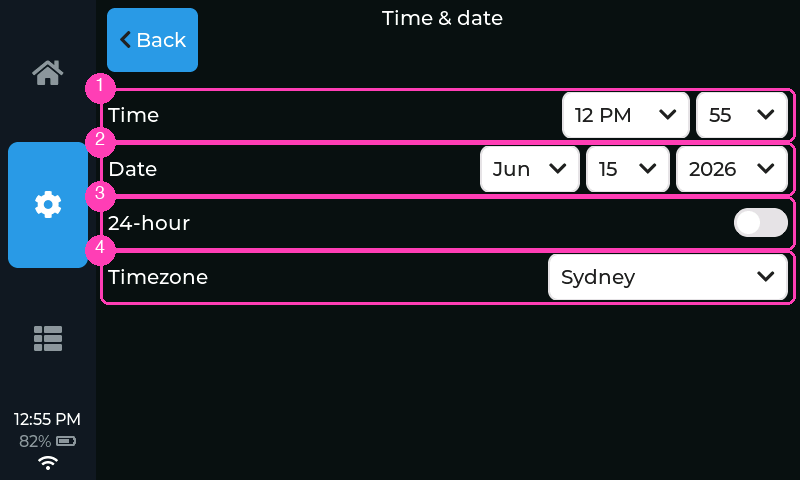

- ① **Time** — hour and minute pickers, to set the clock by hand. (With Wi‑Fi +
  NTP the clock sets itself on every boot; alternatively, boards with an RTC
  and an optional coin cell installed keep time through a power‑off.)
- ② **Date** — month / day / year pickers. NTP fills the date in automatically;
  without NTP a real date is needed for features that stamp records (shot
  history). Setting only the time leaves the date unset.
- ③ **24‑hour** *(default on)* — clock format.
- ④ **Timezone** — city picker (handles daylight saving). Governs how all
  times display and how NTP time is converted.

### WiFi

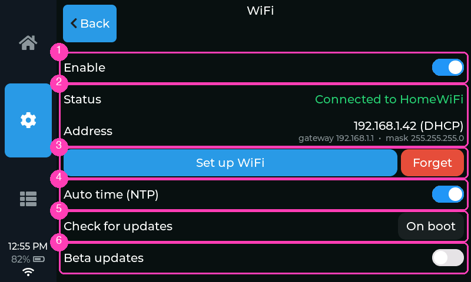

- ① **Enable** *(default off)* — join your home network. Used only for NTP time
  sync; all machine/scale control is local Bluetooth.
- ② **Status** — `Off`, `Connecting`, `Connected to ⟨network⟩`, or
  `Connection failed`. While connected an **Address** row appears beneath it
  with the IP and how it was assigned, *(DHCP)* or *(static)*, and the
  gateway and subnet mask in use — so a wrong static entry is visible here
  without opening the portal.
- ③ **Set up WiFi** — starts the device's own access point (`Micra-Setup`) and
  setup page for entering credentials (same flow as token entry: scan the
  QR code on the screen with your phone's camera and the page pops up on its
  own, or join the network and open the shown address). The page also offers
  your **time zone** (optional — the same list as Time & date), so one phone
  visit sets up WiFi and the clock:

  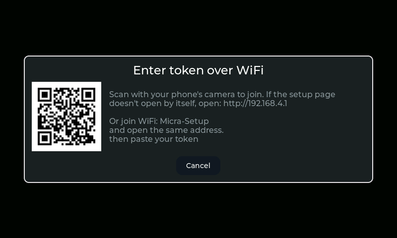

  The page's last control is **Network address**: *automatic (DHCP)*, the
  default, or *static*. Static reveals four fields — IP address, subnet mask
  (255.255.255.0 on most home networks), gateway (your router), and an
  optional DNS server (the gateway when blank). A static address is handy if
  you bookmark the device's web page or reserve addresses on your router.
  There is no on‑device editor for these: to change or clear them, run
  **Set up WiFi** again — the page comes up with your network name and
  address settings pre‑filled, and the password can be left blank to keep the
  saved one, so a one‑field change is just that. Switching back to
  *automatic* is one tap. **Stats → Info** shows the
  current address with *(static)* or *(DHCP)* after it.

- ③ **Forget** — clears the saved network.
- ④ **Auto time (NTP)** *(default on)* — sync the clock over WiFi while
  connected. (The timezone it applies is set under **Time & date**.)
- ⑤ **Check for updates** *(default On boot)* — tap to cycle **Off / On boot /
  Daily / Hourly**. "On boot" checks once at startup; "Daily" and "Hourly" also
  re-check on that interval while the machine stays on — always during an idle
  moment (the idle screen is up), so they never get in the way. If Screen
  timeout is Off, the repeating checks never fire; the startup check and the
  manual button still work. Checks only run after an NTP sync has proven the
  internet is reachable. When a newer firmware exists, a notice shows the
  version and its release notes:

  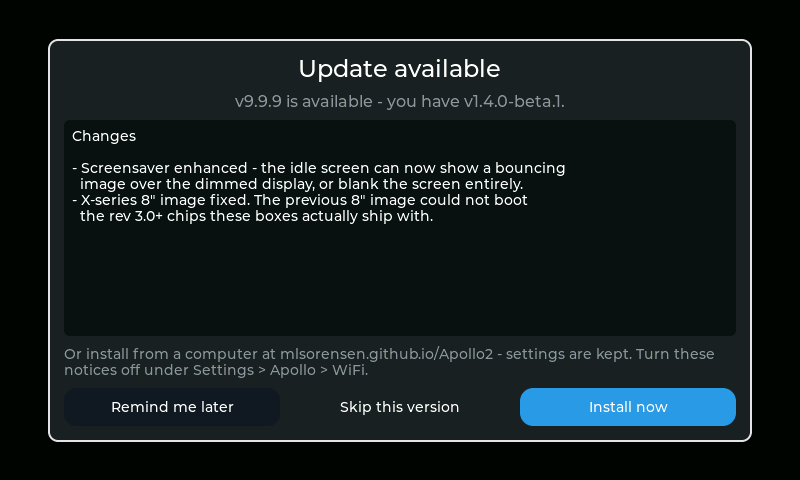

  **Install now** installs it right on the device (see below); **Remind me
  later** closes the notice and offers again on the next check; **Skip this
  version** never offers that version again (the next release will). You can
  also check any time from **Stats → Info → Check for updates** — and if it
  can't reach the server it says "Couldn't check" rather than "up to date".

  **Installing** — after **Install now**, Apollo restarts into a minimal update
  screen: a progress bar while it downloads the new firmware, then a short
  **"screen goes dark for about 20 seconds — don't power off"** phase while it
  writes, then it restarts on the new version. Your settings, the paired
  machine, and shot history are kept, and a firmware that fails to boot rolls
  back to the old one automatically. **If an update fails partway** — a
  download that can't complete, or a new build that doesn't boot — the device
  simply comes back on the version it had, and the notice appears again at the
  next check; **Remind me later** or **Skip this version** keeps it out of the
  way while the cause is sorted out. (The check also won't offer a version
  until that version's image for your board is actually being served, so a
  release that is still publishing doesn't get offered early.) The
  [web flasher](https://mlsorensen.github.io/Apollo2/) remains the fallback for
  recovery and for a board's very first flash.

  **Updates that need a computer** — once in a while a release changes the
  part of the firmware that starts the board, which can't be updated over
  WiFi. The notice then says the version **must be installed from a
  computer** and has no Install button: open the
  [web flasher](https://mlsorensen.github.io/Apollo2/) in Chrome or Edge and
  connect Apollo with USB — settings, the paired machine and shot history are
  kept. Firmware older than v1.1 doesn't know about this and offers Install
  anyway; such a release's notes start with **WEB FLASH REQUIRED**, and an
  install from the device fails and comes back on the version it had.

- ⑥ **Beta updates** *(default off; shown only while checks are on)* — also
  offer pre-release builds, named like `0.14.0-beta.1`. Betas ship the next
  release early so it can be tested on real machines; they are less proven than
  a normal release, and the notice, the install and the automatic roll-back on
  a firmware that won't boot all work exactly the same.

  Switching the toggle re-checks straight away, so the next notice matches the
  channel you picked. Turning it **off** while running a beta does not move you
  back on its own — the device stays on that build until a stable release is
  newer than it (`0.14.0` supersedes `0.14.0-beta.2`), which is usually days.
  To go back sooner, reflash the stable release from the
  [web flasher](https://mlsorensen.github.io/Apollo2/); your settings and
  history are kept.

### Backup

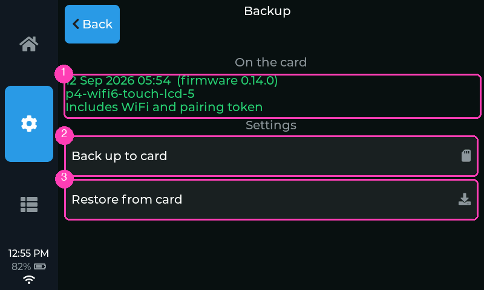

Your settings live inside Apollo, not on the memory card — so moving the card
to another one brings every shot across and none of your preferences. This page
copies the settings onto that same card, so a replacement can pick them up.

- ① **On the card** — what the inserted card holds: when the backup was taken,
  the firmware and board it was taken on, and whether it carries your WiFi
  network and pairing token. Otherwise `No card inserted` or `No settings
  backup on this card`.
- ② **Back up to card** — writes every setting to `/Apollo2/settings.txt`,
  beside your shots. It is plain text, readable on any computer:

  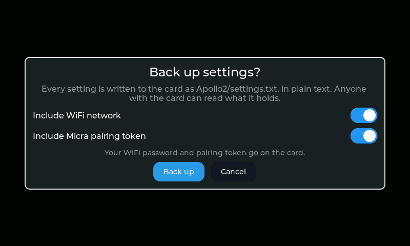

  The two switches decide whether your **WiFi network** (name and password) and
  your **Micra pairing token** go onto the card with everything else. Both are
  on by default — the point of a backup is a replacement that just works — and
  turning one off means setting that up by hand later, which is the trade worth
  making if the card won't stay with the machine. Everything else (theme,
  chime, target weight, flush settings, schedule, timezone, and the rest)
  always travels.
- ③ **Restore from card** — replaces every setting on this Apollo with the
  backup, then restarts to apply it. Anything the backup doesn't carry — a
  setting added in a later firmware, or a credential you left out — goes back
  to its default. Greyed out when the card holds no backup.

A few things worth knowing:

- **Moving between boards is the point.** A backup taken on any supported board
  restores onto any other; nothing in it is board-specific. Settings that
  belong to the board itself — the paddle pin repair knobs and the Paddle
  wiring choice — stay on the board and are untouched by a restore.
- **A backup from newer firmware is refused** — update this Apollo first, then
  restore. Older backups are always fine.
- **Nothing happens on its own.** No automatic backup, no automatic restore;
  swapping cards between machines never changes a setting by itself.

### Storage

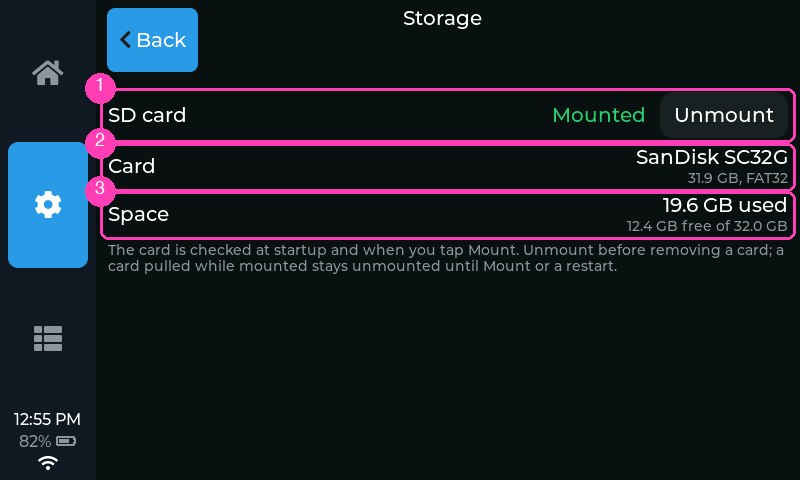

The memory card that holds your shot history (and any settings backup). The
slot is checked **once at startup** and otherwise only when you ask — the
device does not keep polling for a card, so this page is where a card goes in
and comes out.

- ① **SD card** — `Mounted` (in use), `No card`, `Unsupported format` (see
  the History section: reformat as FAT32), `Removed` (the card was pulled
  while mounted — nothing is lost, but it stays unmounted until you say so),
  or `Unmounted, safe to remove`. `Mounted, FULL` means new shots are not
  being saved. The button beside it is **Mount** or **Unmount**:
  - **Mount** — insert a card, tap Mount. A restart does the same thing.
  - **Unmount** — finishes any write and releases the card so you can take it
    out cleanly. Shots brewed while unmounted are not recorded (Home and
    History say so).
- ② **Card** — the card's make and model as it reports itself, its capacity
  and filesystem (`FAT32`, or the unsupported one it came with).
- ③ **Space** — used, free and total space on the card.

> Why the button: on the P4 boards the card slot and the WiFi/Bluetooth
> radio share one bus controller, and searching an empty slot every few
> seconds was found to disturb the radio badly enough to restart the device
> (v1.1.0). Checking once at startup and when you tap Mount removes that;
> a mounted card in normal use never did it.
- **Your shots aren't part of this** — they are already on the card, and a
  restore doesn't touch them.

### Root page

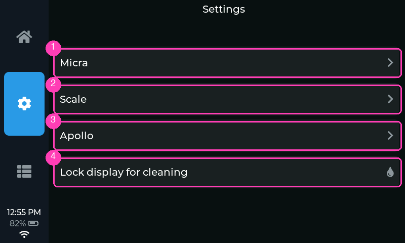

The rows ①–③ open the **Micra**, **Scale**, and **Device** pages above; one
action lives directly on the root:

> **Shortcut:** while you are anywhere inside Settings, tapping the Settings
> tab again returns straight to this root page — one tap instead of several
> Backs when crossing from, say, Apollo → Display to Micra → Controls.

- ④ **Lock display for cleaning** — disables touch for 30 seconds so you can
  wipe the screen. A full‑screen countdown shows the time remaining; the lock
  ends on its own (touching the screen does nothing until then).

  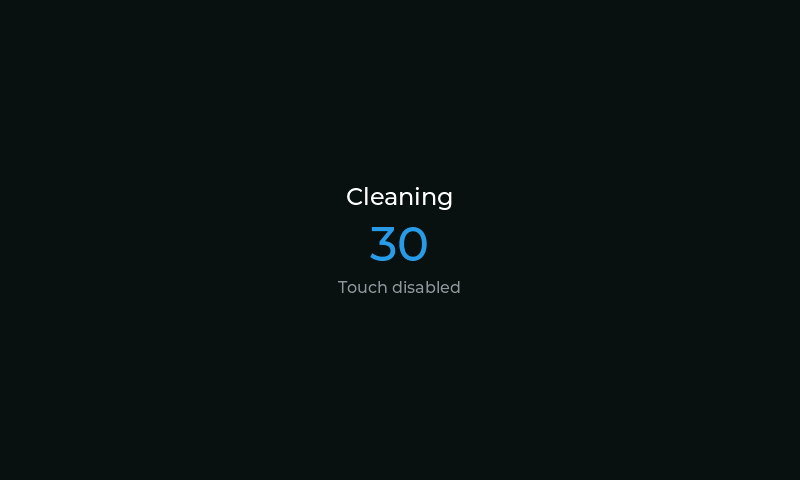


---

<a id="stats-section"></a>

## Stats

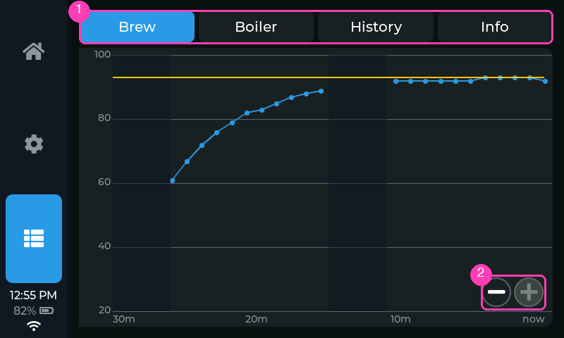

- **Brew / Boiler** — temperature history graphs, chosen with the selector ①.
  Tap **+/−** ② to zoom the time
  window; the set‑point is drawn as a reference line; gaps mean the machine was
  disconnected.

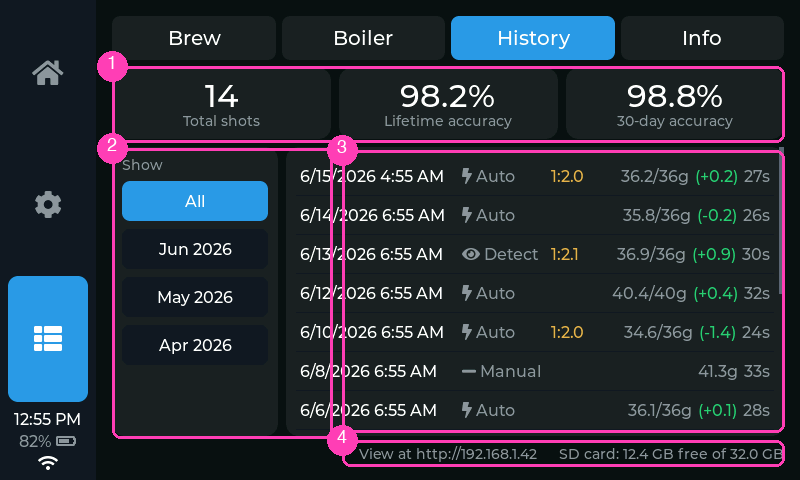

- **History** — the shot log (boards with an SD‑card slot). Headline cards ① show
  lifetime totals: shots recorded, lifetime accuracy and 30‑day accuracy
  (actual vs target weight). Below, the shot list ③ with a calendar filter ② —
  **All** plus a button for each month that has shots, so an old month is one
  tap away instead of a long scroll. The footer ④ shows the web address and
  SD‑card space. Each row shows the signed miss against
  target — `36.2/36g (+0.2)` — green within 2 g, amber beyond, and how the
  shot was run: a bolt for an **Auto** shot (the paddle harness stopped it at
  weight) or an eye for a **Detect**ed one (inferred from the scale). Only
  those two modes record — a fully manual shot has no armed start/stop, so
  nothing is saved. Tap a shot for a full‑screen card with its
  result/target/diff, time, average flow, the brew ratio when the shot
  recorded a dose, and the weight + flow graph:

  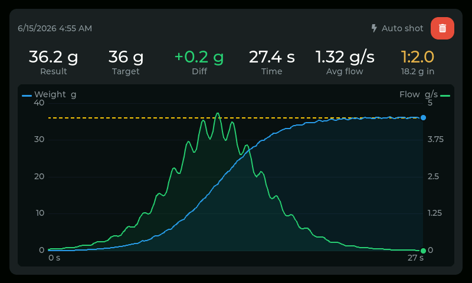

  - **SD card**: any size — a **small card is more than enough**. A shot is
    a few tens of KB, so even a 1 GB card holds decades of daily espresso;
    an old card from a drawer is perfect. Use a card formatted **FAT32**
    (FAT16 also works) — small cards usually ship that way. exFAT — the
    factory format of most cards over 32 GB — and NTFS are **not**
    supported: History detects what's on an unusable card and names it
    ("This SD card is exFAT‑formatted…") instead of pretending the slot is
    empty. Reformat on a computer; the device never formats or erases a card
    on its own.
  - **Inserting and removing**: the slot is checked at startup and when you
    tap **Mount** on Settings → Apollo → Storage; a freshly inserted card is
    not picked up on its own (see that page for why). Use **Unmount** there
    before pulling a card; one pulled while mounted is noticed within a few
    seconds, History switches to its guidance, and the slot stays idle until
    you Mount again or restart. If the card fills up, new shots stop being
    saved and History says so.
  - **What's recorded and when**: recorded shots are viewable immediately —
    no clock needed. Recording NEW shots additionally needs a real date/time
    (NTP, or Settings → Apollo) — until the clock is set the footer warns
    that shots aren't being saved. Records live on the card under `/Apollo2`
    — an index CSV plus one samples CSV per shot — so the whole history can
    be read on any computer (graphs are drawn from the data by the device
    and the web page; nothing is pre‑rendered — the CSVs are the database).
  - **Delete a shot**: open its card and tap the red trash button, then
    confirm. The shot's files are removed from the card and the headline
    stats recalculate without it — handy for throwing out dial‑in or
    practice shots. This one *is* destructive (unlike Reset stats below).
  - **Reset stats**: tap any headline card. Non‑destructive — the three
    headline numbers restart from now (the Total card shows "Since ⟨date⟩")
    while every recorded shot stays on the card. Undo by deleting
    `Apollo2/stats_since.txt` on a computer.
  - **Browse from your phone or computer**: with WiFi connected, open
    `http://⟨device IP⟩/` (the IP is on **Stats → Info**). The device serves
    its own web page — the same stats, month filters, and shot list, with a
    live graph per shot, a **Download card** button that saves any shot as a
    PNG image (composed in your browser from the raw data), and CSV
    downloads — all styled to match whatever theme the device is currently
    using. The same built‑in web server also carries the setup pages during
    pairing/WiFi setup, so nothing conflicts.
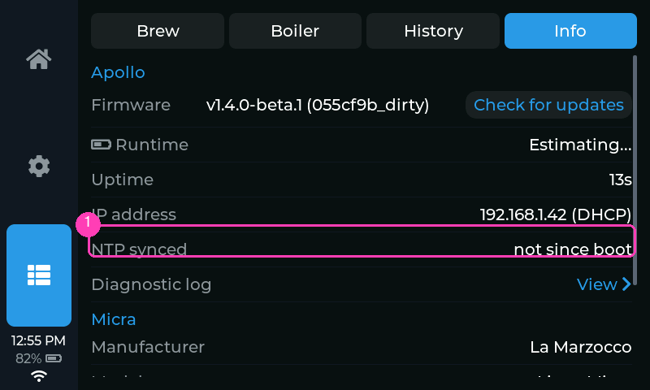

- **Info** — device details: our firmware version + git revision, uptime,
  battery/USB state with a runtime estimate, the **IP address** with how it
  was assigned — *(DHCP)* or *(static)*, see [WiFi](#wifi) —, **NTP synced** (how long ago the
  clock last synced over the internet, or "not since boot"), and the machine's
  Device Information (manufacturer, model, serial, firmware) read over Bluetooth.
  - **Check for updates** — next to the firmware version, tap it to check the
    releases site right now (needs WiFi + NTP). It reports back either an
    update notice or "You're on the latest firmware" — the same check the boot
    option runs, on demand.
  - ① **Diagnostic log** — tap **View** for the recent diagnostic log (the same
    messages the USB serial console prints), each line stamped with the time
    (or seconds‑since‑boot before the clock is set). The log lives in RAM:
    it survives as long as the device stays powered and holds the last
    64 KB — typically hours of normal operation — so "the paddle did nothing
    this morning" can be diagnosed after the fact without a serial cable.
    It does not survive a reboot. The on‑screen viewer shows the newest few
    KB; with WiFi connected, `http://⟨device IP⟩/log` serves the whole
    thing as plain text (there's also a **Log** link on the web page's
    header) — easy to copy into a bug report.
  - **Touch check** — if the screen ever stops answering touches while
    the rest of the device still runs (the screensaver keeps playing, the
    web page still loads), `http://⟨device IP⟩/api/touch` asks the touch
    controller directly whether it is still alive, and
    `http://⟨device IP⟩/api/touch?reset=1` resets just the touch controller
    in place — no reboot, nothing else is touched. Please fetch the first
    one before the second and include both in a bug report.
  - **Crash dumps** — if the firmware ever crashes and reboots, it saves a
    post‑mortem snapshot (a *coredump*) to internal flash first. On the next
    boot the log notes `crash dump stored`, and with WiFi connected a
    **Crash dump** link appears in the web page's header (next to **Log**;
    `http://⟨device IP⟩/coredump` directly also works) that downloads it as a
    file — attach it to a bug report and the exact cause can be pinpointed.
    The filename is a fingerprint of the build that *crashed* (dumps survive
    firmware upgrades, so that isn't always the version currently
    installed); it matches the `.appsha` files in the release's
    debug‑symbols archive, which is how the right decoding symbols are
    found. The dump survives reboots and even firmware
    upgrades until the next crash overwrites it;
    `http://⟨device IP⟩/coredump?erase=1` clears it manually.

---

<a id="bbw-reference"></a>

## Brew‑by‑weight quick reference

| | Auto shot | Shot detect | Manual |
|---|---|---|---|
| Needs paddle wiring | **Yes** | No | No |
| Shot start | Paddle flip | Detected from weight (back‑dated by **Detect lead‑in**) | Paddle flip (wired) / — |
| Shot stop | **Automatic** at target − learned overshoot | You flip the paddle (pill flashes **Stop** at the right moment) | You flip the paddle |
| Auto‑tare at start | Yes | No (delta‑based) | No |
| Overshoot learning | Yes | No | No |
| Review graph + frozen weight | Yes | Yes | No |
| Auto flush eligible | Yes | Yes (wired boards) | No |

Wiring the paddle harness — parts, photos of the Micra's paddle loom, and
per‑board terminals — is covered in the [wiring guide](docs/WIRING.md), as
is the optional **Apollo Link** board for the P4 boards only (paddle
pass‑through when Apollo is off, power over the same cable; nothing to set
in the firmware). It does not work with the S3‑4.3C.

### Paddle pin protection & per‑unit remapping

- **Protect the sense pin.** The P4 boards' paddle inputs are plain GPIO
  pins. The [wiring guide](docs/WIRING.md) puts a 1 kΩ resistor and a 100 nF
  capacitor in the paddle‑sense wire, in the screw‑terminal block, which keeps
  the pin inside its rated range against the switch's own ringing and against
  transients the cable can carry; and it says to plug the paddle block in with
  the board powered off. Two cheap parts, no change in behaviour.
- **The paddle breaker.** A failing sense pin announces itself: it starts
  registering paddle flips that nobody made, dozens a minute, each one a shot
  start. Apollo watches for that signature — raw flickers too short to be a
  hand, or accepted flips shorter than half a second, several of either within
  a minute — and when it sees it, switches the paddle drive off, refuses every
  flush and cleaning cycle, hands the paddle back to the machine on an Apollo
  Link (the machine then works as stock), and shows a modal explaining what it
  saw. Ordinary use does not trip it — a quick flick, a flush‑flush‑shot
  morning, a ten‑cycle manual backflush all pass; only a run of several
  sub‑half‑second pulses, or a line that flickers too fast to be a hand, does
  (touching bare sense wires together during a bench test can). Tap
  **Reset** once you have looked at the wiring; if the flicker is still there
  it trips again at once, which is itself the diagnosis. A reboot also clears
  it. The diagnostic log records each trip with its counts.
- **If a paddle pin ever does fail** (symptom: the paddle stops registering
  or behaves erratically while everything meters fine — the diagnostic log's
  `Paddle: raw sense ...` lines will show a line stuck, drifting, or flipping
  on its own; the X‑8 that failed logged hundreds of phantom flips an hour
  before the pin went deaf), the pins are **remappable per unit** without a custom firmware
  build: move the wire to a free GPIO on the header, connect the device over
  USB, and run

  ```
  make padsense PIN=21      # sense wire moved to GPIO21 (example)
  make paddrive PIN=49      # drive wire, same idea
  make padsense PIN=-1      # revert to the board default
  ```

  (or type `padsense=21` into any serial monitor). The setting is stored in
  the device's settings memory — it survives reflashes and web‑flasher
  upgrades, so stock releases keep working on a remapped unit — and takes
  effect on the next boot, which logs it: `Paddle: sense GPIO21 (NVS
  override)`. The board's default pins stay unchanged for everyone else.
  A dead pin on the set you are *not* using needs no remap at all: set
  **Settings > Micra > Controls > Paddle wiring** to your cable and the
  firmware stops reading that set.
