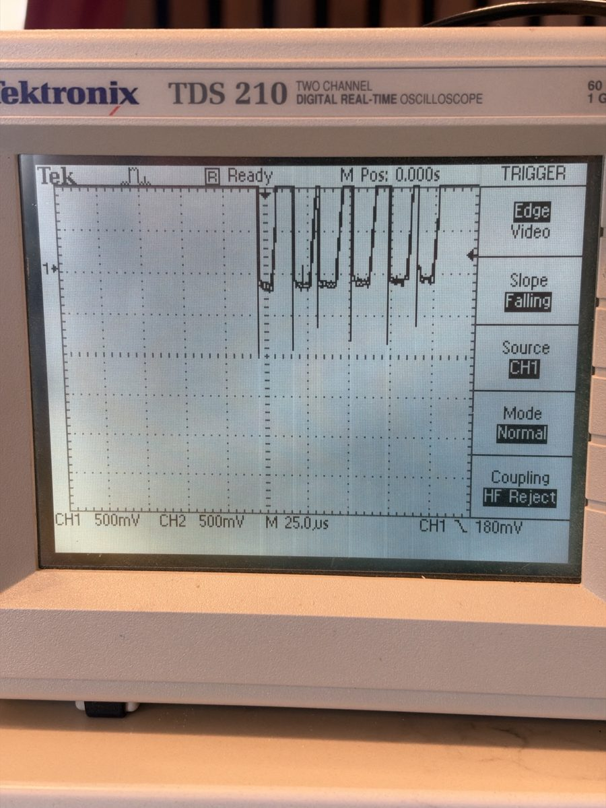
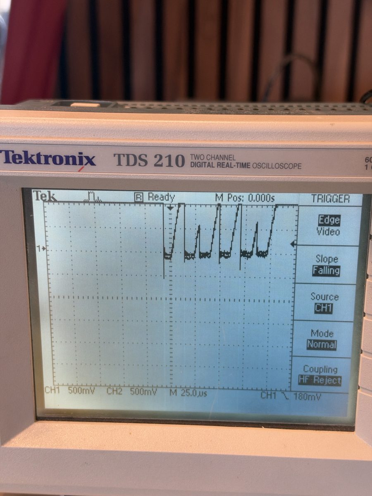
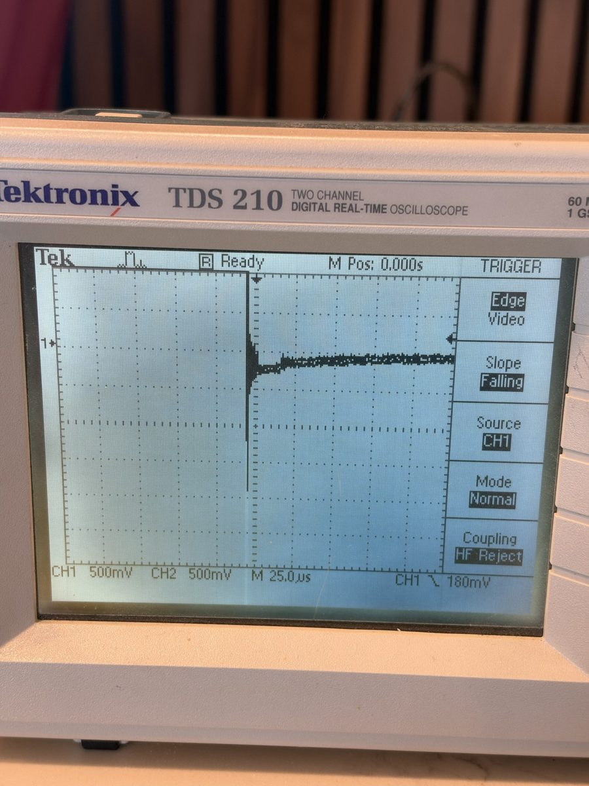
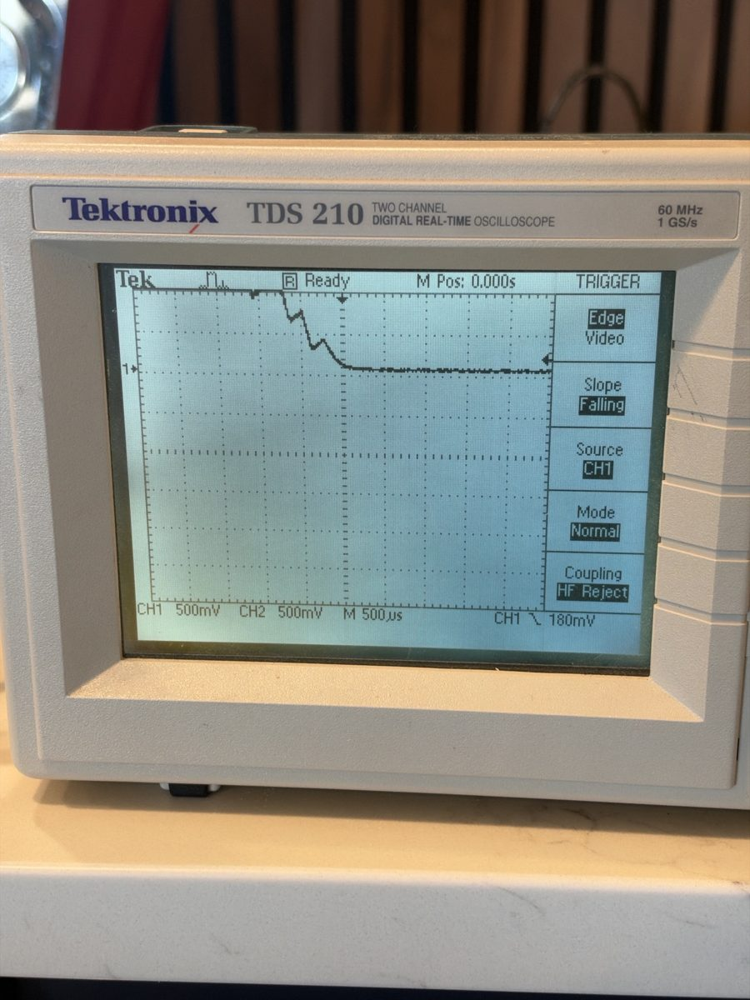
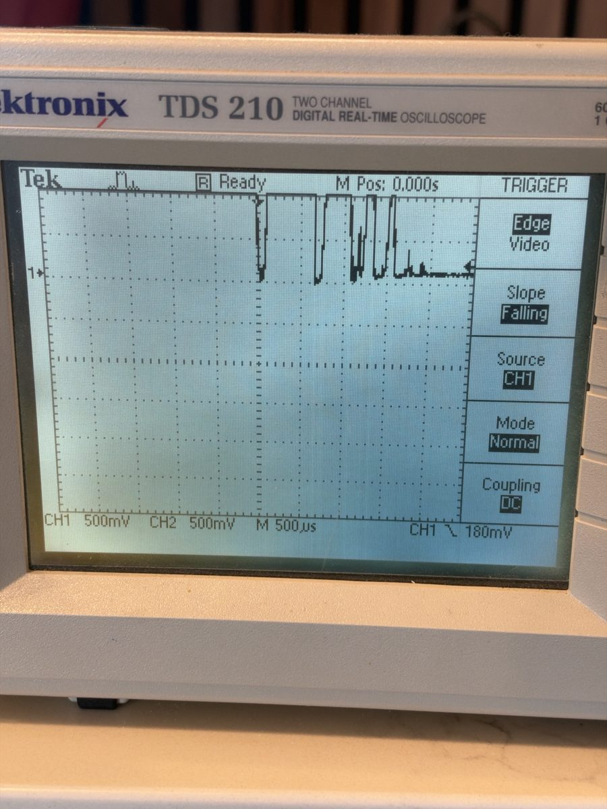
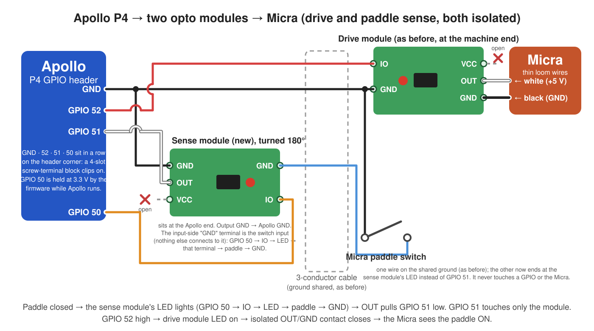

# Protecting the paddle sense pin: 1 kΩ in series, then 100 nF at the pin

- **Status:** Open (the recipe stands; what killed the two dead pads is unproven)
- **Area:** hardware
- **First decided:** 2026-07-31 · **Last changed:** 2026-11-03
- **Boards:** P4-5, P4-4.3, X 8" (any board whose paddle sense is a bare native GPIO). The S3-4.3C senses through an on-board opto and is unaffected.

## Context

On the P4 boards the physical paddle switch wires straight to a GPIO
(GPIO51 on the header corner, GPIO5 on the Apollo Link set) through about
two metres of cable, with only the pad's internal pull-up behind it. Two
sense pads have died that way, both with the same signature: hours of
phantom closures while the machine was warm, then a deaf input
([the two pads](#ev-dead-pads)). Drive pads have never failed.

## Decision

The DIY cable keeps ONE opto module (the drive) and adds two parts in the
paddle-sense wire, fitted in the 4-slot terminal block at the Apollo end:
a **1 kΩ resistor in series**, then **100 nF from the pin side of it to
GND**. Order matters: wire, resistor, pin, capacitor on the pin's side.
The same two parts also work spliced in at the machine end of the
cable (WIRING.md). Never a capacitor alone. Plug the block in with the
board powered off.
Apollo Link rev 0.7 carries the equivalent on the board (C1 100 nF plus an
opto and an ESD diode on SENSE; see the Link record). The firmware side is
the paddle breaker (its own record).

Why this pair, [on the scope](#ev-scope): a bare switch wire rings the
pad to about -1 V at every bounce closure, 1 kΩ alone halves it, a
capacitor alone rings to -1.7 V, and 1 kΩ then 100 nF leaves nothing
below zero; machine events put nothing above the rail. A
[two-module cable](#alt-two-module) was as clean and was dropped: a
second module and a firmware-held supply pin for what two passives give.

## Consequences

- The wiring guide and the manual's "Paddle pin protection" say the
  above; a cable built without the parts gains them in the block.
- The 75 ms glitch filter stays ([its origin](#history)); the pump puts
  nothing over the rail, so the RC does not address what the filter
  guards against.
- A dead corner pad is remapped per unit (`padsense`, `paddrive`: NVS,
  outside backups); a dead Link pad is handled by pinning the unit to the
  other wiring (`padwire`, the Paddle wiring setting;
  [its short-lived predecessor](#history)).
- **Unproven:** what killed the two pads. Every in-service measurement is
  clean except the per-flip ring on a bare wire (half of it present
  behind rev 0.6's 1 kΩ), and whether that ring wears a pad is not
  established ([what would settle it](#ev-open)). Until then these are
  hypotheses, confirmed on the bench before they harden into code.

---

## Details

### Evidence

**The two dead pads.**

| unit | pin | wiring | died | evidence |
|---|---|---|---|---|
| bench P4-5 | GPIO51 | bare wire, the guide's first opto-cable recipe | 2026-07 (observed 2026-07-30 per the comment in paddle.cpp; diagnostics committed 2026-07-31) | reads LOW at cold boot with the pull-up armed and nothing attached (`244ab4f`) |
| bench X 8" | GPIO5 | Apollo Link rev 0.6 (1 kΩ series) | 2026-11-02 | 238 accepted phantom ON edges in 2 h; pad 3.13 V open, 0.415 V held (`4fdaea0`; "five times the pull-up current" per the working notes); drive and CTRL pads fine |

Only an offline scale kept the X 8"'s pump off that night.

What would settle the cause: a scope armed at the pin
for days, a diode-mode comparison of the dead GPIO5 against a healthy
pad, a capture at the Link's J2 during a shot.

**Scope session, 2026-11-03.** A 60 MHz scope (Tek
TDS 210) in Peak Detect, probe on the X 8"'s GPIO51 terminal (a healthy
pad), ground clip on Apollo GND. Paddle flips, trigger Falling at
-180 mV, trigger coupling HF Reject (photo 05: DC) unless noted. The
amplitudes and timings in the table are read off the photos below (the
1.5 ms figure is from the working notes; the staircase starts above the
screen at 500 mV/div).

| wiring at the pad | trace | photo |
|---|---|---|
| bare switch wire to the pin | about -1 V at every bounce closure (6-7 closures in ~150 µs), each under 1 µs: the pad's lower clamp conducts on every flip | 01 |
| 1 kΩ in series (the 2026-07-31 advice; rev 0.6's R6) | about -0.5 V per closure: halved, not fixed | 02 |
| 100 nF alone at the pin | bounce spikes gone, but one -1.7 V ring at first contact (the charged capacitor shorted through the cable's inductance): worse | 03 |
| 1 kΩ, then 100 nF on the pin side | clean: a ~1.5 ms staircase to 0 V, nothing below zero | 04 |
| two-module cable (opto transistor at the pin) | clean with nothing added: every low plateau on zero | 05 |

Machine events (pump running, flush, shot) with the trigger at +4.5 V
rising: nothing above the rail on either wiring. The plug/unplug captures
(±45 V at mains frequency, a 100 V flick, a "13.5 V pk-pk" reading) were
all taken with the probe on the open wire and a hand on the block: the
floating potential of the operator's body and an unearthed charger,
microamps behind it, not an event at the pad.

Scope photos (probe on the GPIO51 terminal of the X-8, ground clip to
Apollo GND; the CH1 marker at the left edge is 0 V):

*01: bare wire to GPIO51; 500 mV/div, 25 µs/div, Falling -180 mV. About -1 V per closure.*

*02: 1 kΩ in series; same settings. About -0.5 V.*

*03: 100 nF alone; same settings. One spike to about -1.7 V at first contact, then a slow settle.*

*04: 1 kΩ then 100 nF; 500 mV/div, 500 µs/div. Staircase to zero, nothing beneath.*

*05: opto transistor at the pin; 500 mV/div, 500 µs/div, DC. Bounces between 0 V and the rail, nothing below ground.*

### Alternatives and dead ends

- **1 kΩ alone** (advised 2026-07-31; the 4-slot block of 2026-08-09): halves the ring. Rev 0.6 Links have exactly this and one still lost its pad.
- **Capacitor alone**: worse ([photo 03](#ev-scope)).
- **Two-module cable** (2026-11-02): a second PC817 module at the Apollo end with the switch in its LED loop, fed from the header's 3V3 pin in the first version (`1130719`) and from GPIO50 held high by firmware from the next morning (`0eaf58c`, the version the diagram below shows). Clean on the scope, dropped 2026-11-03: a second module, a firmware dependency and a GND-labelled switch input for what two passives give. GPIO50 is free again.

  The guide carried it for one day (2026-11-02 to 2026-11-03, commits `1130719` to `1f66549`); its diagram is kept here as the recorded alternative to the RC:

  

  *The two-module DIY cable. The paddle switch completes GPIO50, module IO, LED, switch, GND; the module's transistor pulls GPIO51 low, so the pin touches nothing but a transistor a few centimetres away. Clean on the scope with no R or C. It cost a second module, a fourth terminal slot, a firmware-held supply pin and a wiring step whose switch input is a terminal labelled GND, and it was replaced by the two passives above, which do the same for the pin and need nothing from the firmware.*
- **A dual module board**: rejected, its shared output ground would tie the Micra's black wire to Apollo GND.

### History

- 2026-07-19: 75 ms glitch filter on the sense input after phantom OFF/ON edge pairs, coincident with the machine's wake-up pump kick, started a real brew on the P4 (commit `2b2802c`).
- 2026-07-31: P4-5 GPIO51 found dead (observed the day before); raw-edge logging, pull-up read-back and per-unit pin overrides added; 1 kΩ in the sense wire suggested (`244ab4f`).
- 2026-08-09: the no-solder 4-slot block (`e4c8279`).
- 2026-11-02: X 8" GPIO5 dead on a rev 0.6 Link; two-module cable and Link rev 0.7 (opto on SENSE) drawn (`4fdaea0`, `1130719`).
- 2026-11-03: scope session; recipe reset to 1 kΩ + 100 nF, two-module cable dropped, GPIO50 supply removed (`78cd3e3`, `1f66549`, `e61abcc`); Link rev 0.7 gains C1 and D3.
- 2026-11-03: a serial `lnksense` override for a dead Link sense pad existed for a few hours (`b9d39e0`) and was replaced the same day, unreleased, by the Paddle wiring setting (`padwire`).

### Sources

Commits above; docs/WIRING.md ("The sense RC"); MANUAL.md "Paddle pin protection & per-unit remapping"; src/platform_esp32/paddle.cpp; the Link record `2026-09-16-apollo-link-bridge.md`; the breaker record `2026-11-03-paddle-breaker.md`.
